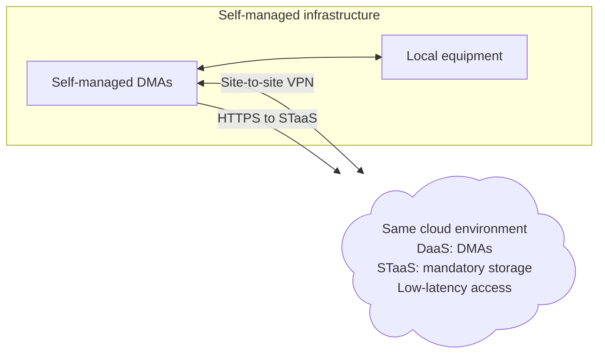

# Hybrid clusters

A hybrid DataMiner cluster combines nodes using a DataMiner as a Service (DaaS) deployment with self-managed nodes. This creates one clustered DataMiner System (DMS) that can span both cloud and on-premises infrastructure. Between the DaaS nodes and the self-managed nodes, a site-to-site VPN connection is set up.

> [!NOTE]
> Hybrid clusters are not supported with [self-managed storage nodes](xref:DM_and_storage_selfhosted). STaaS is mandatory for every node in a hybrid cluster.

> [!TIP]
> For technical details, refer to [Combining DaaS and self-managed nodes in one cluster](xref:Creating_hybrid_cluster).

## When a hybrid cluster fits

A hybrid cluster is not required to monitor both cloud and on-premises equipment. A DaaS system can reach private equipment through a site-to-site VPN or [DataMiner Edge](xref:DataMiner_Edge), without a self-managed node in the cluster. See [Connecting to private data sources](xref:Connecting_to_private_data_sources) and [Reaching your data sources](xref:Overview_Architecture_and_components#reaching-your-data-sources).

A hybrid cluster is useful when you specifically need full DataMiner nodes in both environments. One of the following situations can be enough:

- You are migrating between self-managed infrastructure and DaaS, and you want to keep one operational system during the migration.
- You need a self-managed DataMiner node for functionality or integrations that DataMiner Edge does not provide, alongside DaaS nodes.
- You want to temporarily add cloud capacity to a self-managed cluster, for example for an event or a seasonal peak.

All nodes run the same DataMiner version. Choose a cloud region close enough to the self-managed nodes to meet the [network requirements](xref:DataMiner_Compute_Requirements#network) between DataMiner nodes.

## Temporary capacity

Adding capacity for an event requires more than adding a node. Identify which workloads can move to the extra nodes, make sure these nodes can reach the data sources of those workloads, and check whether storage and network paths can handle the extra load. [Swarming](xref:Swarming) can move supported elements to the new nodes, but it does not make local equipment reachable from the cloud.

Plan the end of the event as carefully as the start. Move the workloads back to the permanent nodes, confirm that these have enough capacity, and then follow the supported procedure to remove the extra nodes. For costs, see the [DaaS sizing guide](xref:Pricing_sizing_guide_services_DaaS).

## Maintenance

Skyline maintains the DaaS nodes and STaaS, and manages [DaaS backups](xref:Creating_a_DaaS_system_FAQ#what-backup-policy-does-a-daas-system-have). You maintain the self-managed nodes, their backups, and your VPN endpoint.
