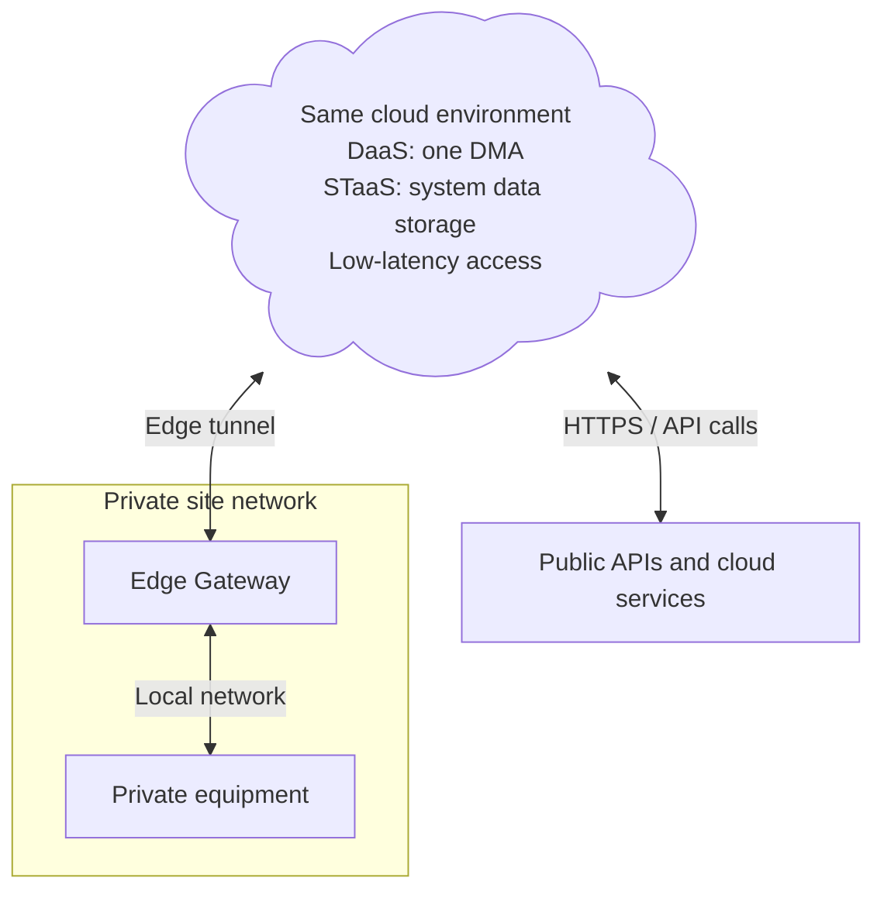
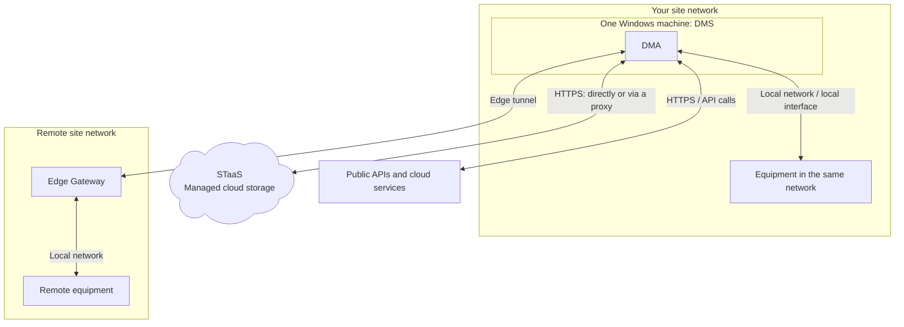
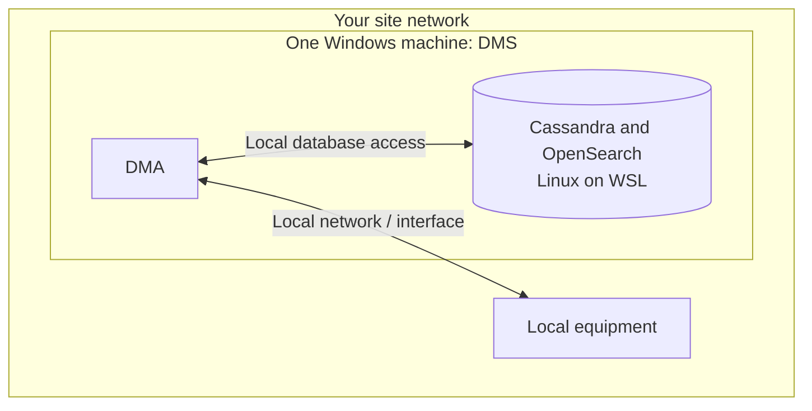

# One-box system

A one-box system is a complete DMS whose compute workload runs on a single Agent. It is the smallest compute topology: one DataMiner server or virtual machine, rather than a multi-server compute cluster. That one box can be hosted through DaaS or self-managed. With STaaS, storage runs as a managed service outside the box; the local WSL variation also puts the databases on the same machine.

## When this topology fits

You may choose this topology because your workload fits one node, you are evaluating DataMiner, or your operation can tolerate the node being unavailable during maintenance or recovery. These are examples, not cumulative requirements. A small production system can use this topology if its availability requirements permit it.

The data sources can be public APIs, private equipment, or a combination. A DaaS DMS can reach private sources through a site-to-site VPN or DataMiner Edge; see [Connecting to private data sources with DaaS](xref:Connecting_to_private_data_sources). A self-managed DMS can use direct local access, routed network access, or DataMiner Edge to reach remote sites.

## Common use cases

- **Small monitoring installations**: One DMS manages a limited workload at a facility where compute downtime is acceptable.
- **Proofs of concept**: Quickly connect representative devices or APIs and evaluate a solution without deploying a compute cluster.
- **Development labs**: Build and test connectors, scripts, and packages in an isolated DMS.
- **Training and demonstrations**: Run a complete system with simulated or selected real data on one compute machine.
- **Limited non-production environments without STaaS**: Run local Linux databases on WSL alongside DataMiner, within the documented test and staging restrictions.

The one-box footprint is a deployment choice, not a sizing guarantee. Size the whole workload and revisit redundancy if the system becomes operationally critical.

## Deployment variations

### DaaS with STaaS

The DMS has one cloud-hosted DMA. A DaaS system always uses STaaS, which is hosted in the same cloud environment for low-latency storage access. Private equipment can be reached through Edge or a site-to-site VPN; equipment does not need to be publicly accessible.

This example uses an Edge Gateway for visual clarity. A site-to-site VPN is another option for DaaS. An Edge Node can instead run compatible integrations locally; see the [distributed topology](xref:Architecture_distributed_sites#example-connections-across-sites).

### Self-managed one-box DMS with STaaS

The DMA is in your own network and uses STaaS in the cloud. This example uses an Edge Gateway to reach equipment at a remote site.

STaaS keeps the local footprint to one DMA, without local database servers.

### Self-managed one-box DMS with local WSL databases

For limited non-production use, both the DMA and Linux databases run on one Windows machine. This example shows local equipment only; remote access can be added if needed.

Unlike STaaS, this storage shares the machine's resources and failure domain with the DMA. This variation is for limited non-production use, not normal production.

### Choosing a variation

- **DaaS with STaaS**: Skyline operates the compute infrastructure and storage. STaaS is the only storage option for DaaS. You configure the system and provide a supported path to your data sources.
- **Self-managed DMS with STaaS**: You operate one Windows compute machine and Skyline operates storage. This suits an existing server platform or a requirement to run the DMS locally. Outbound HTTPS to STaaS is required.
- **Self-managed DMS with local WSL databases**: Cassandra and OpenSearch run locally on Linux through Windows Subsystem for Linux. This reduces the number of machines, not the combined resource requirements or maintenance responsibilities. Use the [pre-installed DataMiner Virtual Hard Disk](xref:Using_a_pre_installed_DataMiner_Virtual_Hard_Disk) and follow its platform-specific restrictions. The local-storage setup is intended for small test, development, and staging environments, not normal production use.

For WSL, provide resources for DataMiner and both database components, and enable nested virtualization where required by the VHD instructions. See [DataMiner Compute Requirements](xref:DataMiner_Compute_Requirements) and [Single DMA storage setups](xref:Dedicated_clustered_storage#single-dma-setups).

## Availability and growth

One DMA has **no compute redundancy**. STaaS provides storage redundancy, but does not take over a failed DMA. With local WSL storage, compute and databases share the same machine, so a host failure affects both. Plan downtime for maintenance and test your restore procedure.

If the load outgrows one node, move to a [centralized cluster](xref:Architecture_centralized_cluster). If availability becomes critical, add an appropriate redundancy model even if the workload still fits one DMA. A local WSL deployment that grows beyond its intended scope needs migration to STaaS or dedicated storage and [decommissioning of WSL](xref:Decommissioning_WSL).

## Operations and getting started

For DaaS, Skyline manages backups under the [DaaS backup policy](xref:Creating_a_DaaS_system_FAQ#what-backup-policy-does-a-daas-system-have). For a self-managed DMS, configure [DataMiner backups](xref:Backing_up_a_DataMiner_Agent_in_DataMiner_Cube) outside the box. STaaS provides daily storage backups retained for 30 days; with local databases, you must arrange database backups as well.

For DaaS, start with [Creating a DMS on dataminer.services](xref:Creating_a_DMS_on_dataminer_services). For a self-managed DMS with STaaS, use the [DataMiner installer](xref:Installing_DM_using_the_DM_installer) and [STaaS setup instructions](xref:Setting_up_StaaS). Compare costs using the [DaaS sizing guide](xref:Pricing_sizing_guide_services_DaaS) and [STaaS sizing guide](xref:Pricing_sizing_guide_services_StaaS).
