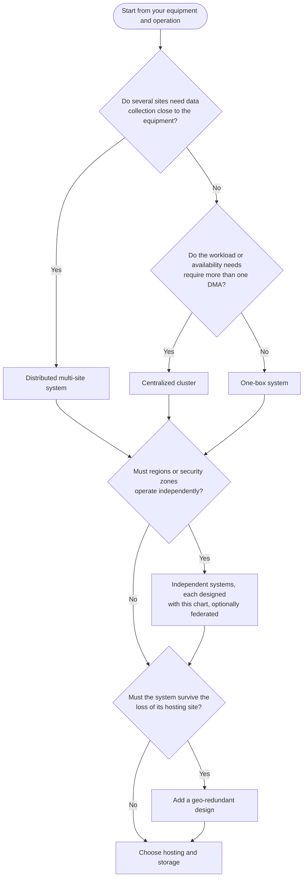

# DataMiner System architecture and components

This page explains the components of a DataMiner System (DMS), how they reach your equipment and storage, and how to choose an architecture. It then points you to [example architectures](#choosing-an-architecture) that you can use as a starting point for your own operation.

## General architecture

DataMiner manages your devices, applications, and services through **elements**. An element is a DataMiner representation of one data source, such as an encoder, a modulator, an antenna controller, or a cloud API. Each element uses a **connector**, which defines how DataMiner communicates with that type of data source. See [DataMiner components](xref:DataMiner_components) for an introduction to these concepts.

A DataMiner System (DMS) is a cluster of one or more TCP/IP interconnected nodes, also known as DataMiner Agents (DMAs). Each of these DataMiner nodes is identical as to software. Each node is a fully functional DataMiner System by itself, offering all the features and capabilities of DataMiner.

This means that the smallest and simplest version of a DataMiner System is a single DataMiner Agent. Typically, multiple nodes are deployed in a cluster, with the number of nodes depending on the required overall processing capacity and potentially also on certain architectural considerations or preferences.

In a DataMiner cluster, there is no central node, and there are no dedicated client terminals. When DataMiner users log on to any of the nodes in the cluster, they will perceive the cluster as a single entity.

### DataMiner Agents

A DataMiner Agent (DMA) is a physical or virtual compute instance running the DataMiner Agent software on top of a Microsoft Windows operating system (see [DataMiner Compute Requirements](xref:DataMiner_Compute_Requirements)). It hosts elements and runs functionality such as alarm handling, trending, automation, and the web applications.

The DataMiner Agent software is essentially a collection of services, of which most names start with "SL" (for example, SLNet, SLProtocol, SLLog, etc.).

> [!TIP]
> See also: [Installing a DataMiner Agent](xref:Installing_a_DataMiner_Agent)

### Clients

DataMiner client applications only need to connect to one node in the cluster, and this can be any of the nodes. All nodes in the cluster have an equivalent status. Through this "single point of contact", users have access to all information in the entire cluster. The only constraints a user can potentially experience in terms of accessing certain information are defined by the DataMiner security configuration.

In other words, a [DataMiner client](xref:Client_apps) can access the cluster by connecting to any DataMiner node, and it will get a consolidated view of the entire managed operation and all its managed objects across all nodes in the cluster.

## Hosting and storage

The DataMiner nodes can be hosted by Skyline with [DataMiner as a Service (DaaS)](xref:DaaS_hosting), or you can host them yourself on premises, in a private cloud, or in a public cloud. Each DMS also needs **system data storage**, which can be [Storage as a Service (STaaS)](xref:STaaS), hosted by Skyline, or [dedicated clustered storage](xref:Dedicated_clustered_storage) that you host yourself on Linux machines.

These choices are explained in [DataMiner deployment models](xref:Overview_hosting). Keep the following in mind when you read the example architectures:

- A DaaS system always uses STaaS, hosted in the same cloud environment as its DataMiner nodes.
- A [hybrid cluster](xref:Hybrid_clusters), combining DaaS nodes and self-managed nodes, also requires STaaS.
- Hosting and storage are separate from the architecture itself. Most example architectures can be cloud-hosted, on premises, or a combination.

To store and retrieve data, the DataMiner System relies on references and IDs. This makes the database less readable for a third-party software application without intimate knowledge of the data structures used by DataMiner. The system data storage is therefore considered to be exclusively used by the DataMiner System.

An optional second data storage solution or [offload database](xref:Offload_database) can be added to a DataMiner System for the purpose of exporting the data and making it available for third-party software applications. When the DataMiner System is configured to also offload its data to the offload database, it will translate the data to more human-readable data (for example, element ID references are replaced with element names), so that it is easier for third-party applications to digest. A DataMiner System will only write data to the offload database but will not read from it. The DataMiner System will also not perform maintenance of the offload database.

## Reaching your data sources

Your equipment does not need to be located next to the DataMiner nodes, and private equipment does not require an on-premises DMS. The following options can be combined within one DMS, for example per site:

| Option | How it works | Typical use |
|--|--|--|
| Direct or routed network access | The DMA polls the equipment over the local network, a WAN, or the internet. | Equipment in the same network as a self-managed DMS, and public APIs or cloud services. |
| Site-to-site VPN | A VPN connects the private network to the cloud environment of a DaaS system. Only available for DaaS. | Private networks with many data sources that should be reachable from DaaS. See [Connecting to private data sources](xref:Connecting_to_private_data_sources). |
| [Edge Gateway](xref:About_Edge_Gateways) | A secure tunnel lets integrations running on the central DMS reach equipment at a remote site. | Remote sites such as headends, transmitter sites, or distant teleports, for DaaS and self-managed systems. |
| [Edge Node](xref:About_Edge_Nodes) | A lightweight runtime at the site runs compatible Python-based integrations locally and buffers collected data during connection interruptions. Currently available in preview. | Sites with limited or intermittent connectivity, where data collection should continue during an outage. |
| DataMiner Agent at the site | A full DMA at the site is part of the same DMS and polls the local equipment. | Sites that need local functionality that Edge does not cover, with reliable connectivity to the rest of the cluster and to storage. |

Edge requires a DMS [connected to dataminer.services](xref:Connecting_your_DataMiner_System_to_the_cloud), and Edge components are not DataMiner Agents. Check the [Edge Gateway limitations](xref:About_Edge_Gateways), for example regarding SNMP traps, before you choose this option for a specific integration. See [DataMiner Edge](xref:DataMiner_Edge) for more information.

## Redundancy

A DataMiner System is only as redundant as its weakest component: redundant DataMiner nodes still depend on the availability of the storage, the network, and the managed equipment.

- **DataMiner nodes**: With [Swarming](xref:Swarming), elements and other supported objects can be moved between the DMAs of a cluster. Combined with [Node Recovery](xref:NodeRecovery_About), the remaining nodes can automatically take over the workload of a failed node, provided that they have enough spare capacity and can reach the equipment. Swarming replaces the older [Failover](xref:failover) feature, which has reached [End of Engineering](xref:Software_support_life_cycles).
- **Storage**: STaaS provides zone-redundant storage by default, with optional geo-redundant storage. See [STaaS data location and redundancy](xref:STaaS_features#data-location-and-redundancy). For self-managed storage, see [Dedicated clustered storage](xref:Dedicated_clustered_storage).
- **Sites**: Surviving the loss of a complete site requires redundant nodes, storage, and connectivity at another location. See [Geo-redundant system](xref:Architecture_geo_redundant).
- **Devices**: [Redundancy groups](xref:About_redundancy_groups) switch between primary and backup devices, independently of the system architecture.

## One system or several

One DMS keeps configuration, storage, and upgrades together, and gives one operational view. Its DataMiner nodes need reliable, low-latency connectivity to each other and to the storage (see the [network requirements](xref:DataMiner_Compute_Requirements#network)).

Separate systems are useful when regions, organizations, or security zones need to operate and be upgraded independently, or when the connectivity between locations is not suitable for one cluster. Selected data can still be shared between systems, for example with [element replication](xref:Replicated_elements). See [Independent and federated DataMiner Systems](xref:Architecture_multiple_systems).

## dataminer.services

dataminer.services is a cloud platform hosted by Skyline that provides various services. While it is not mandatory for a DataMiner System to be connected to this platform, the connection is required to have access to some DataMiner features.

The most full use of dataminer.services is [DataMiner as a Service](xref:Creating_a_DMS_in_the_cloud), where the entire DataMiner System is hosted by Skyline in the cloud. It is also possible to only have the system data storage hosted by Skyline with [Storage as a Service](xref:STaaS). But even if you host a DataMiner System entirely on your own compute instances, being connected to dataminer.services provides a host of additional features, including dashboard sharing, access to all DataMiner artifacts in the Catalog, DataMiner Edge, [Proactive Support](xref:Proactive_Support), and proactive health monitoring with [CDMR](xref:CDMR).

For an overview of all dataminer.services functionality, refer to [dataminer.services](xref:Overview_dataminer_services).

## DataMiner Probes

A DataMiner Probe (DMP) provides standalone intelligent network management functionality, and typically reports to a central system. It has limited capabilities compared to a full DataMiner Agent, and typically, but not necessarily, runs on a small-form-factor compute instance in remote and unmanned locations where communication channels often have capacity constraints and/or intermittent availability.

DMPs can support a multitude of applications and are typically installed in for example remote VSAT terminals, satellite hubs, terrestrial transmitter sites, small network nodes, cellular network base stations, etc.

For data collection at remote sites, also consider [DataMiner Edge](#reaching-your-data-sources).

## Choosing an architecture

Start from your operation rather than from the infrastructure:

- **Where is the equipment?** At one location, spread over many sites, or in the cloud? Can it be reached centrally, or should data collection happen close to it?
- **How large is the workload?** The number of devices, parameters, polling rates, trending, alarms, and solutions such as EPM determine the [compute requirements](xref:DataMiner_Compute_Requirements).
- **What must remain available?** Define how long the system may be unavailable after the loss of a node, a link, or a complete site.
- **What must stay separate?** Consider security zones, data residency, and independent change schedules.

The following chart suggests a starting point. You do not need to meet every criterion of an example architecture; one or more may be enough to make it a good fit.

| Example architecture | Situation it addresses |
|--|--|
| [One-box system](xref:Architecture_single_agent) | The smallest footprint: a complete DMS on one DataMiner Agent, for small installations, proofs of concept, labs, and training. |
| [Centralized cluster](xref:Architecture_centralized_cluster) | The most common deployment: one operational DMS with centrally hosted nodes, scaled or made redundant as needed. |
| [Distributed multi-site system](xref:Architecture_distributed_sites) | One operational view, with data collection close to the equipment at several sites. |
| [Geo-redundant system](xref:Architecture_geo_redundant) | Continuity when a complete hosting site is lost. |
| [Independent and federated DataMiner Systems](xref:Architecture_multiple_systems) | Separation between regions, organizations, or security zones, with an optional central view. |

### Typical starting points per industry

Your requirements determine the architecture more than your industry does, but the following examples can help you get started:

| Industry | Typical starting point |
|--|--|
| Broadcast (TV and radio) | A redundant [centralized cluster](xref:Architecture_centralized_cluster) for studios, playout, and the air chain. A [distributed system](xref:Architecture_distributed_sites) for regional stations or transmitter sites, and a [geo-redundant design](xref:Architecture_geo_redundant) for a main and backup facility. |
| Media services, playout, and live production | A [centralized cluster](xref:Architecture_centralized_cluster) for booking and orchestration across local and cloud resources, with temporary extra capacity for events where needed. |
| OTT, streaming, and cloud media | A [one-box system](xref:Architecture_single_agent) or [centralized cluster](xref:Architecture_centralized_cluster) that reaches cloud services and APIs directly, and private headends through Edge or a VPN. |
| Satellite operators and teleports | A [centralized cluster](xref:Architecture_centralized_cluster) for one teleport, a [distributed system](xref:Architecture_distributed_sites) for several teleports, and a [geo-redundant design](xref:Architecture_geo_redundant) for a main and backup teleport. |
| Satellite and VSAT service providers | A [centralized cluster](xref:Architecture_centralized_cluster) that collects terminal data through vendor APIs and hub equipment, without equipment at every terminal. |
| Cable and telecom operators | A [centralized cluster](xref:Architecture_centralized_cluster) for central aggregation, for example with [EPM](xref:EPM), or a [distributed system](xref:Architecture_distributed_sites) for many headends and hubs. |
| Transport, rail, and utilities | A [distributed system](xref:Architecture_distributed_sites) for many stations or substations, or [independent systems](xref:Architecture_multiple_systems) for strictly separated operational networks. |
| Government, defense, and public safety | [Independent systems](xref:Architecture_multiple_systems) per security zone, using self-managed storage where networks are air-gapped. |

### Sizing and design guidelines

Size the DataMiner nodes and any self-managed database nodes using the [DataMiner Compute Requirements](xref:DataMiner_Compute_Requirements). For services, see the [DaaS sizing guide](xref:Pricing_sizing_guide_services_DaaS) and the [STaaS sizing guide](xref:Pricing_sizing_guide_services_StaaS).

Before you finalize a design, check the [architecture design considerations](xref:Architecture_design_considerations). These cover network and platform requirements, backups, common pitfalls, and how to use lab and staging systems alongside production.

For a design outside these examples, contact your Skyline account manager or [DataMiner Support](mailto:support@dataminer.services).
