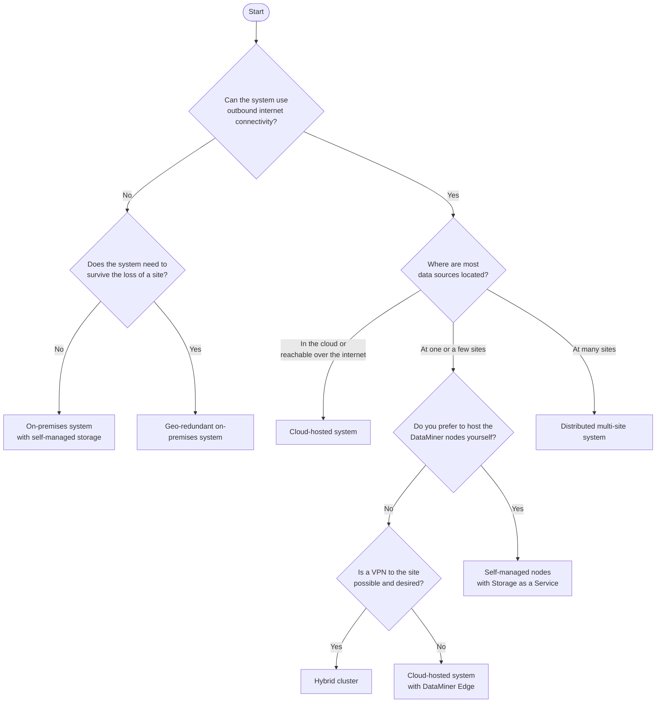

# DataMiner System architectures

A DataMiner System (DMS) can be deployed in many different ways: fully in the cloud, fully on premises, or anywhere in between. The right architecture depends on where the equipment and services you want to manage are located, how critical the system is for your operation, which network and security constraints apply, and how much infrastructure you want to maintain yourself.

This section describes a number of **generic reference architectures**. Each one explains when it is a good fit, what it looks like, and what its strengths and trade-offs are in terms of redundancy, maintenance, backups, and operational effort. You can use these architectures as a starting point and combine them where needed. Real-life systems often grow from one architecture into another, for example from a small single-node setup into a clustered or hybrid system.

> [!TIP]
> If you are new to DataMiner, first read [Building blocks of a DataMiner System](xref:Architecture_building_blocks). It explains the components that all architectures in this section are made of, such as DataMiner Agents, storage, and the available redundancy features.

## Questions to ask before you choose

The following questions will help you narrow down your options:

1. **Where are the data sources?** Are the devices, applications, and services you want to manage reachable over the internet or via public APIs, or are they located in private networks at one or more of your sites? Do some of them require a physical connection, such as a serial port?

1. **Can the system connect to the internet?** Cloud-hosted components such as [DataMiner as a Service (DaaS)](xref:DaaS_hosting) and [Storage as a Service (STaaS)](xref:STaaS) require outbound internet connectivity. A fully isolated (air-gapped) network requires a fully self-managed system.

1. **How critical is the system?** Determine how long the system can be unavailable, how much historical data you can afford to lose, and whether you need to survive the loss of a complete site.

1. **How many sites are involved, and how good are the links between them?** Latency, bandwidth, and the reliability of wide area network (WAN) links largely determine whether you can run one system across all sites or whether it is better to keep sites more independent.

1. **Who will maintain the infrastructure?** Self-managed DataMiner nodes and especially self-managed databases require knowledge of operating systems, virtualization, and database administration, as well as time for patching, upgrades, monitoring, and backups.

1. **How large is the system now, and how large will it be in a few years?** The number of elements, the amount of trending and alarm data, and the solutions you use (for example EPM or MediaOps) determine the [compute requirements](xref:DataMiner_Compute_Requirements).

## Decision guide

The diagram below gives a simplified view of how the answers to these questions lead to one of the architectures described in this section. It is a guideline, not a strict rule. Many systems combine several of these architectures.

If your organization has strict separation between regions, business units, or security zones, also consider [multiple independent DataMiner Systems](xref:Architecture_multiple_systems). For test, staging, and proof-of-concept environments, see [Lab, staging, and proof-of-concept systems](xref:Architecture_lab_and_staging).

## Comparison of the architectures

The table below summarizes the architectures described in this section. The infrastructure effort refers to the infrastructure you need to operate yourself, not to the configuration of DataMiner itself.

| Architecture | Typical use | Redundancy options | Your infrastructure effort | Internet required |
|--|--|--|--|--|
| [Cloud-hosted system](xref:Architecture_cloud_hosted) | Cloud-native workflows, public APIs, remote sites reachable via VPN or DataMiner Edge | Multiple DaaS nodes, Swarming, zone- or geo-redundant storage | Very low | Yes |
| [Self-managed nodes with Storage as a Service](xref:Architecture_self_managed_staas) | Equipment in private networks, existing virtualization platform | Failover or Swarming, zone- or geo-redundant storage | Medium: DataMiner nodes only | Yes, outbound HTTPS |
| [Hybrid cluster](xref:Architecture_hybrid_cluster) | Mix of cloud resources and on-premises equipment in one system | Nodes in the cloud and on premises, Swarming, managed storage | Low to medium | Yes, plus a site-to-site VPN |
| [On-premises system with self-managed storage](xref:Architecture_on_premises) | Isolated or air-gapped networks, data that must stay within your own premises | Failover or Swarming, clustered Cassandra and OpenSearch | High: DataMiner nodes and databases | No |
| [Geo-redundant on-premises system](xref:Architecture_geo_redundant) | Systems that must survive the loss of a complete site | Nodes and database replicas at two sites, tie-breaker at a third location | Very high | No |
| [Distributed multi-site system](xref:Architecture_distributed_sites) | Many stations, headends, teleports, or remote locations managed centrally | One or more DataMiner nodes per site, shared storage | Medium to high, depending on the storage choice | Depends on the storage choice |
| [Multiple independent DataMiner Systems](xref:Architecture_multiple_systems) | Separated regions, business units, or security zones | Per system, optionally with element replication between systems | Multiplied by the number of systems | Depends on the systems |
| [Lab, staging, and proof-of-concept systems](xref:Architecture_lab_and_staging) | Development, testing, training, evaluation | Usually none | Low | Depends on the deployment |

> [!NOTE]
> The architectures in this section are generic examples. They do not cover every possible situation. If you are unsure which architecture suits your needs, or if you need a setup that is not described here, contact your Skyline account manager or [DataMiner Support](mailto:support@dataminer.services).

## Further reading

- To find out which architectures are commonly used in your industry, see [Architectures by market segment](xref:Architecture_market_segments).
- For network, platform, backup, and sizing guidelines that apply to all architectures, see [Architecture design considerations](xref:Architecture_design_considerations).
- For more information on the deployment and commercial models, see [DataMiner deployment models](xref:Overview_hosting) and [Commercial and deploy models summary](xref:Pricing_Commercial_Models).
