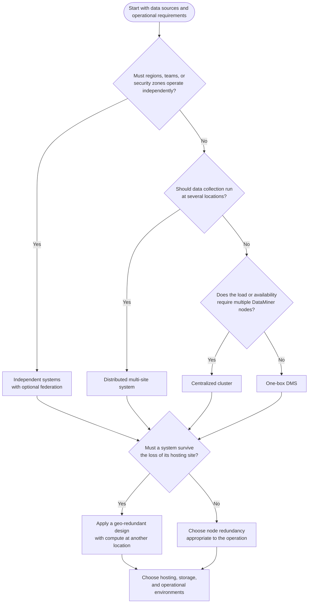

# DataMiner System architectures

The right DataMiner System (DMS) architecture starts with your situation: where your data sources are, which failures your operation must withstand, and which parts of the system must remain independent. These requirements determine the **system topology**, meaning how DataMiner Agents and systems are arranged.

Hosting and storage are related but separate choices. A centralized cluster, for example, can run on DataMiner as a Service (DaaS) or on your own servers. Private data sources do not require an on-premises cluster: a cloud-hosted system can reach them through a site-to-site VPN or [DataMiner Edge](xref:DataMiner_Edge). See [Connecting to private data sources with DaaS](xref:Connecting_to_private_data_sources) for setup guidance.

Use the architectures in this section as starting points, not as mutually exclusive categories. A distributed system can also be geo-redundant, and each independent system can use a different topology. **You do not need to match every suitability example on a page.** One or more may explain why that topology fits your situation; technical prerequisites, such as connectivity and supported storage, still apply.

If you prefer to start from your industry, see [Architectures by market segment](xref:Architecture_market_segments).

## Key terms

| Term | Meaning |
|--|--|
| DataMiner Agent (DMA) | One server or virtual machine running DataMiner, also called a DataMiner node. |
| DataMiner System (DMS) | One or more DMAs working together as one system, with shared system data storage. |
| DataMiner as a Service (DaaS) | DataMiner nodes hosted and maintained by Skyline in the cloud. |
| Storage as a Service (STaaS) | System data storage hosted and maintained by Skyline. |
| Swarming | Moving supported elements and other objects between DMAs in the same cluster. |
| DataMiner Edge | Components that connect remote or private data sources to a DMS, through a gateway or local integrations on an Edge Node. |
| ZRS and GRS | Zone-redundant storage within one cloud region, and geo-redundant storage with an additional copy in a second region. |

For more detail, see [Building blocks of a DataMiner System](xref:Architecture_building_blocks).

## Questions to ask before you choose

- **Where are the data sources?** Consider network reachability, polling volume, local interfaces, and whether integrations should run centrally or close to the equipment.
- **What must remain available?** Distinguish loss of a node, a network link, a storage component, and a complete site. Define acceptable downtime and data loss.
- **What needs isolation?** Consider security zones, data residency, independent change schedules, and the impact of a failure or configuration change.
- **How good are the links?** Measure latency, bandwidth, and reliability between locations. A local integration is not the same as an independently operational site.
- **What is the expected load?** Devices, parameters, polling rates, trending, alarms, and solutions such as EPM or MediaOps determine the [compute requirements](xref:DataMiner_Compute_Requirements).

## Choosing a topology

The following questions help identify a starting point. Review redundancy separately even after you have chosen a centralized or distributed arrangement.

| Topology | Situation it addresses |
|--|--|
| [One-box system](xref:Architecture_single_agent) | A complete DMS on one compute server or virtual machine, where the workload fits and compute downtime is acceptable. |
| [Centralized cluster](xref:Architecture_centralized_cluster) | The most common multi-node deployment: one operational DMS with centrally hosted compute, scaled or made redundant as needed. |
| [Distributed multi-site system](xref:Architecture_distributed_sites) | One operational view with integrations or DataMiner nodes placed close to data sources at several sites. |
| [Geo-redundant system](xref:Architecture_geo_redundant) | Continuity when a complete compute location or site is lost, with storage and connectivity designed accordingly. |
| [Independent and federated DataMiner Systems](xref:Architecture_multiple_systems) | Separation between regions, teams, security zones, or failure domains, with an optional central DMS gathering selected data. |

## One system or several?

One DMS keeps configuration, storage, and upgrades coordinated. DataMiner nodes in that DMS need reliable connectivity to each other and to storage. The [compute requirements](xref:DataMiner_Compute_Requirements#network) recommend inter-node latency below roughly 30 to 50 ms, depending on the workload. This is a guideline, not a country boundary or a guarantee that every stretched system will work.

Separate systems are useful when sites need independent operation, have incompatible security boundaries, or cannot provide the connectivity required by one cluster. Selected data can still be shared through [element replication](xref:Architecture_multiple_systems#sharing-information-between-systems). If you only need local data collection rather than an independent full system, consider Edge Nodes before deploying an additional DMS.

## Operational choices

Once you understand the topology, choose how to run it:

- **[Hosting and storage](xref:Architecture_hosting_and_storage)**: DaaS or self-managed compute, and STaaS or self-managed databases. On-premises nodes with STaaS are a deployment variation, not a separate topology.
- **[Hybrid deployments and temporary capacity](xref:Architecture_hybrid_cluster)**: Combine DaaS and self-managed DMAs when you need full cluster nodes in both environments, for example for migration or additional capacity during events. Mixed cloud and private data sources alone do not require a hybrid cluster.
- **[Lab, staging, and proof-of-concept environments](xref:Architecture_lab_and_staging)**: Apply a suitable topology to development, evaluation, training, or pre-production testing.

Connect the DMS to [dataminer.services](xref:Architecture_hosting_and_storage#benefits-of-connecting-to-dataminerservices) for Catalog-based deployments, remote access, collaboration, and proactive support and health monitoring. DaaS systems already have this connection.

## Example scenarios

### A broadcaster with a few facilities in one region

For two studios and a playout center, a centralized cluster can reach equipment via the existing network or DataMiner Edge, or via a site-to-site VPN when hosted on DaaS. Where polling should run locally, Edge Nodes or a distributed arrangement can bring integrations closer to the equipment. Add node redundancy for air-chain monitoring, and consider a geo-redundant design if the operation must withstand loss of the hosting facility. Hosting the cluster on premises or using DaaS is a separate operational decision.

### A satellite operator with a main and a backup teleport in different countries

Local interfaces and network reachability may call for integrations at each teleport. If one DMS meets the connectivity requirements, a distributed system with a geo-redundant design can provide a shared operational view. If each teleport must operate independently or links are unsuitable for a cluster, use separate systems and share selected data. In either case, ensure the remaining location can reach the equipment it must manage.

### A small team with one site and about 50 devices

A [one-box DMS](xref:Architecture_single_agent) is a starting point, subject to workload sizing. Host its single compute machine through DaaS or as a self-managed DMS with STaaS, according to who should operate the infrastructure. For limited non-production use without STaaS, local Cassandra and OpenSearch on Linux through Windows Subsystem for Linux (WSL) provide another small-footprint option. If monitoring becomes business-critical, revisit compute redundancy rather than relying on the device count alone.

## Further reading

- [Architecture design considerations](xref:Architecture_design_considerations) covers network, platform, backup, and sizing requirements.
- [DataMiner deployment models](xref:Overview_hosting) and [Commercial and deploy models summary](xref:Pricing_Commercial_Models) describe service and licensing choices.
- For a design outside these examples, contact your Skyline account manager or [DataMiner Support](mailto:support@dataminer.services).
