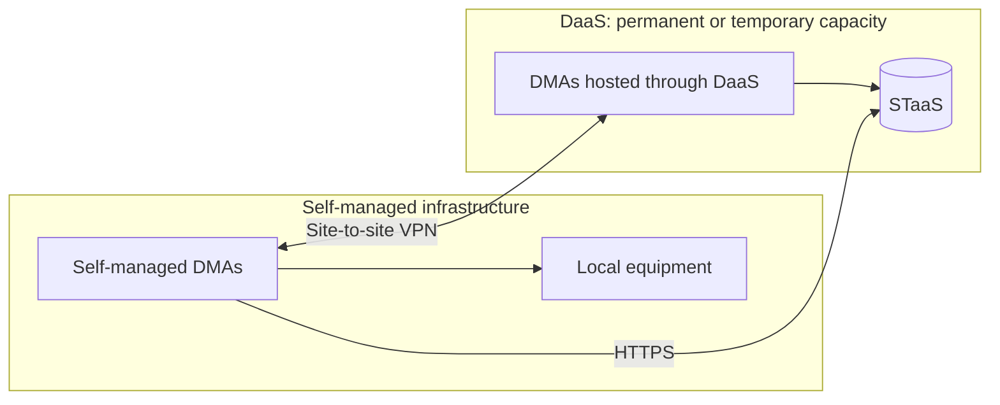

# Hybrid deployments and temporary capacity

A [hybrid cluster](xref:Hybrid_clusters) combines full DaaS nodes and self-managed DataMiner nodes in one DMS. It is an operational variation of a clustered topology, not the default answer to monitoring both cloud and on-premises equipment.

## Start with the connectivity requirement

If your goal is to reach private equipment from cloud-hosted compute, first consider a site-to-site VPN or [DataMiner Edge](xref:DataMiner_Edge). Neither requires a self-managed DMA to join the cluster. See [Connecting to private data sources with DaaS](xref:Connecting_to_private_data_sources) for connectivity options and VPN setup.

An Edge Gateway lets centrally running integrations reach remote sources. An [Edge Node](xref:About_Edge_Nodes) executes compatible Python-based integrations locally and buffers collected data on disk during a connection interruption, synchronizing it when connectivity returns. Edge Nodes are currently in preview and do not replace every function of a full DMA.

This covers many situations previously addressed by local DataMiner nodes. Choose a hybrid cluster when you specifically need **full cluster members** in both hosting environments, rather than just local connectivity or integration execution.

## When a hybrid deployment fits

One of the following may be enough to justify a hybrid deployment; you do not need all of them:

- You are migrating workloads between self-managed infrastructure and DaaS while keeping one operational system.
- You need a full self-managed DMA for functionality or integrations that your selected Edge setup does not provide, alongside DaaS nodes.
- You want to temporarily extend a self-managed cluster with cloud compute for an event, a seasonal peak, or another period of increased processing demand.

Temporary capacity requires planning, not just provisioning a node. Identify workloads that can use the extra compute, ensure they can reach their data sources, and size storage and network paths as well as compute. Where applicable, Swarming can relocate supported workloads; it does not make inaccessible local devices reachable from the cloud.

## Deployment requirements

All nodes use STaaS; hybrid clusters are not supported with self-managed databases. A site-to-site VPN connects DaaS nodes and self-managed nodes, and all DMAs must run the same DataMiner version. See [Combining DaaS and self-managed nodes in one cluster](xref:Creating_hybrid_cluster).

Choose a cloud region close enough to meet the cluster's latency requirements. Maintain the site connectivity needed by both normal operations and recovery. A VPN used only to reach equipment is not itself a hybrid cluster.

## Operating and retiring capacity

Skyline maintains DaaS infrastructure and storage, while you maintain the self-managed compute in your DMS and your VPN endpoints. Coordinate self-managed platform changes with Skyline's DaaS maintenance so the cluster remains version-compatible. Skyline manages [DaaS backups](xref:Creating_a_DaaS_system_FAQ#what-backup-policy-does-a-daas-system-have); configure DataMiner backups for the self-managed compute alongside the storage backup strategy.

For temporary capacity, plan the end of the event as carefully as the start. Move or reassign workloads to the permanent nodes, confirm that they have enough capacity, and follow the supported node-removal procedure before retiring extra nodes. Validate which objects can move and whether the remaining cluster still satisfies the recovery model.

See [Swarming prerequisites](xref:EnableSwarming), [Node Recovery](xref:NodeRecovery_About), and [DataMiner Compute Requirements](xref:DataMiner_Compute_Requirements). DaaS capacity and service costs are covered in the [DaaS sizing guide](xref:Pricing_sizing_guide_services_DaaS).
