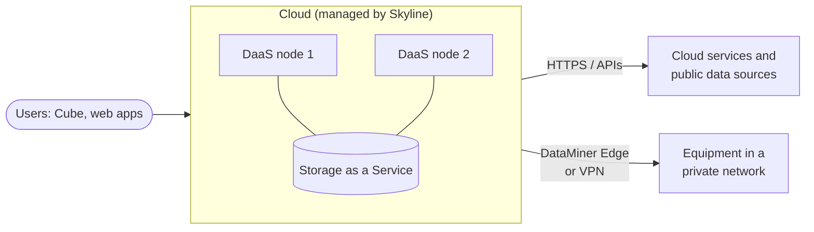

# Cloud-hosted system

In this architecture, both the DataMiner nodes and the storage are hosted in the cloud and managed by Skyline, using [DataMiner as a Service (DaaS)](xref:DaaS_hosting) and [Storage as a Service (STaaS)](xref:STaaS). You do not need to install or maintain any servers yourself.

## When to use this architecture

This architecture is a good fit when:

- Most data sources are cloud services, SaaS platforms, or devices and applications that are reachable over the internet or via public APIs.
- You want to get started quickly, for example for a new project, a trial, or a proof of concept.
- You do not want to manage servers, operating systems, or databases yourself.
- You want to scale up or down easily as your needs change.

It can also be used when data sources are located in private networks, as long as they can be reached in one of the following ways:

- Via [DataMiner Edge](xref:DataMiner_Edge), which connects remote data sources to the central system without the need for a site-to-site VPN.
- Via a site-to-site VPN between the cloud and the remote network.

## Architecture

A minimal system consists of a single DaaS node. You can add nodes as your system grows. The storage is shared by all nodes in the DMS and is scaled automatically.

## Redundancy

- **Compute**: You can deploy multiple DaaS nodes and use [Swarming](xref:Swarming) to move elements between them, for example during maintenance or when a node fails. A single-node DaaS system has no compute redundancy.
- **Storage**: STaaS uses zone-redundant storage by default, which keeps copies of your data in three availability zones in one region. Geo-redundant storage to a paired region is available as an option. See [Data location and redundancy](xref:STaaS_features#data-location-and-redundancy).
- **Connectivity**: When you use DataMiner Edge or a VPN to reach on-premises equipment, the link to each site becomes part of the critical path for monitoring and control of that site. Consider redundant internet connections at critical sites.

## Maintenance and backups

- Skyline maintains the infrastructure, operating system, and storage platform.
- STaaS takes daily backups that are retained for 30 days. See [Data resilience and backups](xref:STaaS_features#data-resilience-and-backups).
- You still decide when to upgrade DataMiner and are responsible for your own configuration, such as elements, dashboards, and Automation scripts. Configure [DataMiner backups](xref:Backing_up_a_DataMiner_Agent_in_DataMiner_Cube) according to your needs.

## Pros and cons

| Pros | Cons |
|--|--|
| No hardware, operating system, or database to maintain | Requires internet connectivity |
| Quick to deploy, with no hardware to install | Reaching equipment in private networks requires DataMiner Edge or a VPN |
| Easy to scale vertically and horizontally | Latency between users or devices and the cloud region can be noticeable when they are far away from it |
| Built-in storage redundancy and backups | Not suitable for air-gapped networks |
| Region can be chosen to meet data residency requirements | Devices that require a physical connection (for example serial) need a local component |

## Regions

When you create a DaaS system, you choose the compute region and the storage region. Choose a region close to your data sources and users to minimize latency. Geographically distributed DaaS systems with nodes in different regions are possible as a custom setup. However, the storage of a DMS is always located in one storage region (optionally with a geo-redundant pair). See [Regional support for DaaS](xref:DaaS_hosting#regional-support-for-daas).

## Commonly used in

- Monitoring and orchestration of cloud-based media workflows, such as cloud playout, live streaming, and cloud production platforms.
- OTT and streaming services that mainly rely on cloud services and APIs.
- Monitoring of satellite terminals, SD-WAN, or other managed services through vendor cloud APIs.
- Organizations with a central operations team that manages smaller remote sites via DataMiner Edge.
- Evaluations, proofs of concept, and training environments.

See also [Architectures by market segment](xref:Architecture_market_segments).

## Sizing

DaaS nodes are sized by Skyline and can be scaled when needed. For an estimate of the cost of the service, see the [sizing guide for DataMiner as a Service](xref:Pricing_sizing_guide_services_DaaS).

## Getting started

- [Creating a DataMiner System on dataminer.services](xref:Creating_a_DMS_on_dataminer_services)
- [About DataMiner Edge](xref:DataMiner_Edge)
