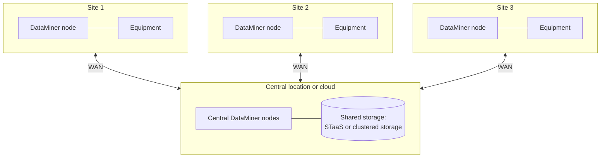

# Distributed multi-site system

In this architecture, one DataMiner System manages equipment at many locations, such as regional TV stations, headends, teleports, transmitter sites, or train stations. Users get one central view of all sites, while the data collection happens as close as possible to the equipment.

## When to use this architecture

This architecture is a good fit when:

- You manage equipment spread over many sites, and you want to operate it from one or more central operations centers.
- Sites are connected via a WAN or the internet, with varying quality.
- Some sites must keep collecting data locally when the connection to the central location is lost.

## Architecture variants

There are several ways to collect data from remote sites. They can be combined within one system.

### DataMiner nodes at the sites

Each larger site has its own DataMiner node that polls the local equipment. All nodes are part of one DMS and share the same storage.

- Polling traffic stays within the site, which reduces WAN traffic and allows local interfaces such as serial connections.
- With [Storage as a Service](xref:STaaS), each site needs outbound internet access. With self-managed storage, each node needs a reliable, low-latency connection to the central database clusters.
- Every node is a full DataMiner Agent that needs to be maintained and upgraded.

### Central polling over the WAN

Smaller sites have no local DataMiner node. The equipment is polled directly from the central DataMiner nodes over the WAN, a VPN, or a [DataMiner Edge Gateway](xref:About_Edge_Gateways).

- Fewer servers to maintain.
- Monitoring of a site stops when the connection to the site is lost. However, the loss of connectivity itself is detected and reported centrally.
- Suitable for sites with a limited number of devices and a stable connection.

### DataMiner Edge Nodes

An [Edge Node](xref:About_Edge_Nodes) runs integrations locally at the site and forwards the data to the central system. This combines local data collection with a light footprint at the site, and it supports operational continuity when connectivity is intermittent. Edge Nodes are currently available in preview.

## Redundancy

- **Central functions**: Make the central DataMiner nodes and the storage redundant as described in the other architectures, for example with multiple nodes and Swarming or Failover, and with STaaS or clustered storage.
- **Sites**: Decide per site whether local redundancy is required. Critical sites can have a Failover pair or multiple nodes. Less critical sites often have a single node or no node at all.
- **WAN**: Do not cluster DataMiner nodes that depend on each other over unreliable WAN links. Design each site so that a WAN failure only affects the visibility of that site, not the rest of the system.

### What happens when a site loses its connection

The impact of a lost connection depends on how the site is connected:

| Site setup | Data collection at the site | Central visibility of the site |
|--|--|--|
| DataMiner node at the site, with STaaS | The node keeps polling its equipment and evaluating alarms, as long as it can still reach STaaS via its own internet access. | Lost until the connection is restored. The loss of connection is reported centrally. |
| DataMiner node at the site, with central self-managed storage | The node can no longer reach the storage, so it cannot keep functioning normally. | Lost until the connection is restored. |
| Central polling, without a node at the site | Polling of the site stops. No data is collected during the outage. | The loss of connectivity is reported centrally. |
| DataMiner Edge Node at the site | The Edge Node is designed to support operational continuity when connectivity is intermittent. | Restored when the connection returns. |

If a site must remain fully operational during a WAN outage, give it a local DataMiner node with its own internet access for STaaS, or consider making it a separate DataMiner System. For the exact behavior in your situation, contact Skyline.

## Maintenance and backups

- All DataMiner nodes in one DMS run the same DataMiner version, so upgrades need to reach every site. Make sure there is enough bandwidth and a maintenance window for each site.
- Use [DataMiner backups](xref:Backing_up_a_DataMiner_Agent_in_DataMiner_Cube) on every node, stored at a location other than the node itself.
- Keep an inventory of which elements run on which site, and use views and naming conventions per site to keep the system manageable.

## Pros and cons

| Pros | Cons |
|--|--|
| One central view and one configuration for all sites | Every node at a site adds maintenance effort |
| Local data collection reduces WAN traffic and supports local interfaces | WAN quality directly affects the system |
| Sites can be added gradually | Upgrades need to be rolled out to all sites |
| Flexible: local nodes, central polling, and Edge can be combined | With self-managed storage, all sites depend on the central database clusters |

## Commonly used in

- Broadcasters with a network of regional stations, studios, or transmitter sites.
- Cable and telecom operators with many headends, hubs, or central offices.
- Satellite operators with multiple teleports and gateway sites.
- Rail, transport, and utility networks with many stations or substations.

See also [Architectures by market segment](xref:Architecture_market_segments).

## Sizing

Size each site node based on the number of elements and the load at that site, according to the [DataMiner Compute Requirements](xref:DataMiner_Compute_Requirements). Small sites with few elements may not need a dedicated node.
