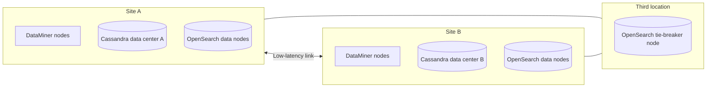

# Geo-redundant on-premises system

In this architecture, one DataMiner System is spread over two sites (for example two data centers), so that the system keeps running when one of the sites is lost completely. The storage is self-managed: Cassandra stores a full copy of the data at each site, and the OpenSearch cluster is spread over the two sites plus a tie-breaker node at a third location.

> [!TIP]
> If your DataMiner nodes can connect to the internet, [Storage as a Service](xref:STaaS) with geo-redundant storage (GRS) can provide geo-redundancy for the storage without the need to operate database clusters at two sites. You still need DataMiner nodes at both sites to take over the workload. See [Surviving the loss of a site](xref:Architecture_building_blocks#surviving-the-loss-of-a-site) and [Self-managed nodes with Storage as a Service](xref:Architecture_self_managed_staas).

## When to use this architecture

This architecture is a good fit when:

- The system is mission-critical and must survive the loss of a complete site, for example because of a power outage, a fire, or a network failure.
- The use of cloud services is not possible or not allowed.
- A reliable, low-latency network connection is available between the sites. As a guideline, the latency between DataMiner nodes should stay within roughly 30 to 50 ms or lower, and the OpenSearch tie-breaker must be below 50 ms.
- You have the expertise and resources to operate distributed database clusters.

## Architecture

- **DataMiner nodes** are present at both sites, for example as Failover pairs with one DMA at each site, or as active nodes at both sites with Swarming.
- **Cassandra** is configured as one cluster with one data center per site, using the [NetworkTopologyStrategy](https://cassandra.apache.org/doc/5.0/cassandra/developing/cql/ddl.html#networktopologystrategy), so each site holds a full copy of the data.
- **OpenSearch** is configured as one cluster with data nodes at both sites and a single tie-breaker node at a third location. The tie-breaker node does not store data, but it allows the cluster to keep a majority when one site is lost. [Shard allocation awareness](https://opensearch.org/docs/2.12/tuning-your-cluster/#advanced-step-6-configure-shard-allocation-awareness-or-forced-awareness) must be configured so that OpenSearch knows which node is at which site.

For more details and the recommended minimum setup, see [Failover setups (with geo-redundancy)](xref:Dedicated_clustered_storage#failover-setups-with-geo-redundancy).

## Network requirements

- A **stable, low-latency connection** is required between the sites. The OpenSearch nodes in particular must not be spread over high-latency links. The tie-breaker node can be hosted in the cloud if the latency is sufficiently low (below 50 ms).
- Every DataMiner node must be able to reach all database nodes it uses.
- Intercontinental distances are generally not suitable for a single stretched OpenSearch cluster. For sites that are far apart, consider [multiple independent DataMiner Systems](xref:Architecture_multiple_systems) instead.

## Redundancy

- **Site loss**: When one site is lost, the DataMiner nodes at the other site take over (via Failover or Swarming), and the storage remains available because the remaining site still holds a full copy of the data and the OpenSearch cluster still has a majority.
- **Network partition**: If the link between the sites fails while both sites are still running, the tie-breaker node determines which side of the OpenSearch cluster remains active. Plan and test how your operators should act in this situation.
- **Consistency**: Data replicated between Cassandra data centers is eventually consistent. Shortly after a site failure, the most recent changes from the lost site may be missing.

## Maintenance and backups

- All maintenance considerations of an [on-premises system with self-managed storage](xref:Architecture_on_premises#maintenance-and-backups) apply, multiplied over two sites.
- Coordinate database upgrades and repairs across both data centers.
- Test site failover regularly. An untested disaster recovery procedure often fails when it is needed most.

## Pros and cons

| Pros | Cons |
|--|--|
| Survives the loss of a complete site | Most complex and most expensive architecture |
| No dependency on internet or cloud services | Requires a low-latency link between the sites and a third location for the tie-breaker |
| Full control over data location | Requires advanced database administration expertise |
| | Network partitions and eventual consistency need to be taken into account in operational procedures |

## Commonly used in

- National broadcasters and broadcast transmission network operators with two main operational centers.
- Satellite operators with a primary and a backup teleport or network operations center.
- Telecom operators and critical infrastructure providers with strict disaster recovery requirements.

See also [Architectures by market segment](xref:Architecture_market_segments).

## Sizing

Each site must be able to carry the full load of the system on its own. Size the DataMiner nodes and database nodes at each site accordingly, based on the [DataMiner Compute Requirements](xref:DataMiner_Compute_Requirements) and the [node calculator](https://community.dataminer.services/calculator/).
