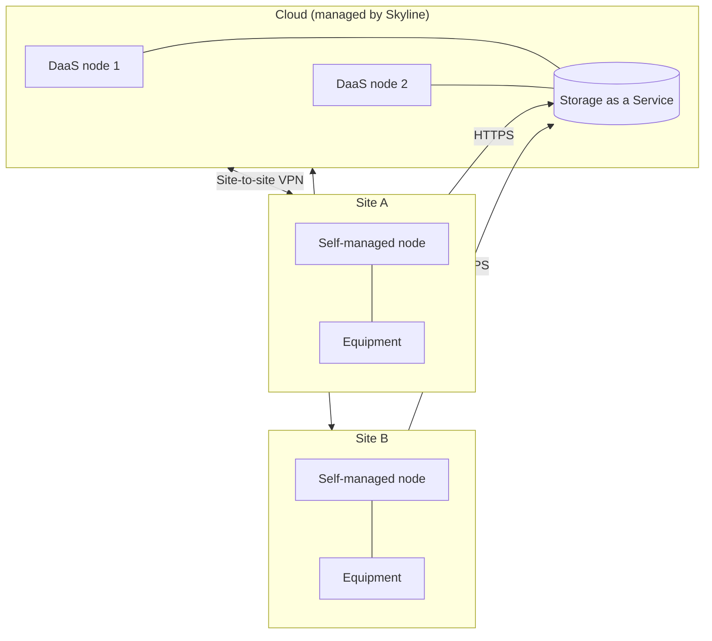

# Hybrid cluster

A [hybrid cluster](xref:Hybrid_clusters) combines [DataMiner as a Service (DaaS)](xref:DaaS_hosting) nodes in the cloud with self-managed DataMiner nodes on premises in one DataMiner System. All nodes use [Storage as a Service (STaaS)](xref:STaaS), and a site-to-site VPN connects the cloud nodes with the on-premises nodes.

## When to use this architecture

This architecture is a good fit when:

- You manage both cloud-based resources and on-premises equipment, and you want to see and operate them as one system.
- Most of the processing can run in the cloud, but some sites need a local DataMiner node, for example because of local interfaces, high polling volumes, or the need to keep monitoring a site locally.
- You want to gradually move a self-managed system to the cloud, or extend a cloud system with on-premises nodes.

## Architecture

## Redundancy

- **Compute**: Use multiple nodes in the cloud and, where needed, multiple nodes per site. [Swarming](xref:Swarming) allows you to move elements between nodes. Keep in mind that elements that need direct access to on-premises equipment can only run on nodes that can reach that equipment.
- **Storage**: Provided by STaaS, with zone-redundant storage by default and geo-redundant storage as an option.
- **Connectivity**: The VPN connections and the internet connections at the sites are critical. Consider redundant VPN tunnels and internet connections for important sites.

## Maintenance and backups

- Skyline maintains the DaaS nodes and the storage. You maintain the on-premises nodes and the VPN endpoints at your sites.
- STaaS takes daily backups that are retained for 30 days.
- All nodes in the cluster must run the same DataMiner version, so plan upgrades for the cloud and on-premises nodes together.

## Pros and cons

| Pros | Cons |
|--|--|
| One system for cloud resources and on-premises equipment | Requires a site-to-site VPN to every site with self-managed nodes |
| No database servers to maintain | Requires STaaS: self-managed storage is not supported in hybrid clusters |
| Fewer on-premises servers than a fully self-managed system | Latency between the cloud region and the sites affects cluster communication |
| Flexible path to move workloads between on premises and the cloud | Responsibilities are split between Skyline (cloud nodes) and you (on-premises nodes and VPN) |

> [!TIP]
> Deploy the DaaS nodes in a region close to your on-premises sites to minimize latency. If you only need to reach remote data sources and do not need a DataMiner node on site, a [cloud-hosted system with DataMiner Edge](xref:Architecture_cloud_hosted) may be simpler than a hybrid cluster.

## Commonly used in

- Broadcasters and media service providers that combine on-premises facilities with cloud-based production or playout.
- Service providers that run central functions in the cloud while keeping local nodes at a few critical sites.
- Organizations that are migrating step by step from on premises to the cloud.

See also [Architectures by market segment](xref:Architecture_market_segments).

## Sizing

The on-premises nodes must meet the [DataMiner Compute Requirements](xref:DataMiner_Compute_Requirements). DaaS nodes are sized by Skyline.

## Getting started

- [Combining DaaS and self-managed nodes in one cluster](xref:Creating_hybrid_cluster)
