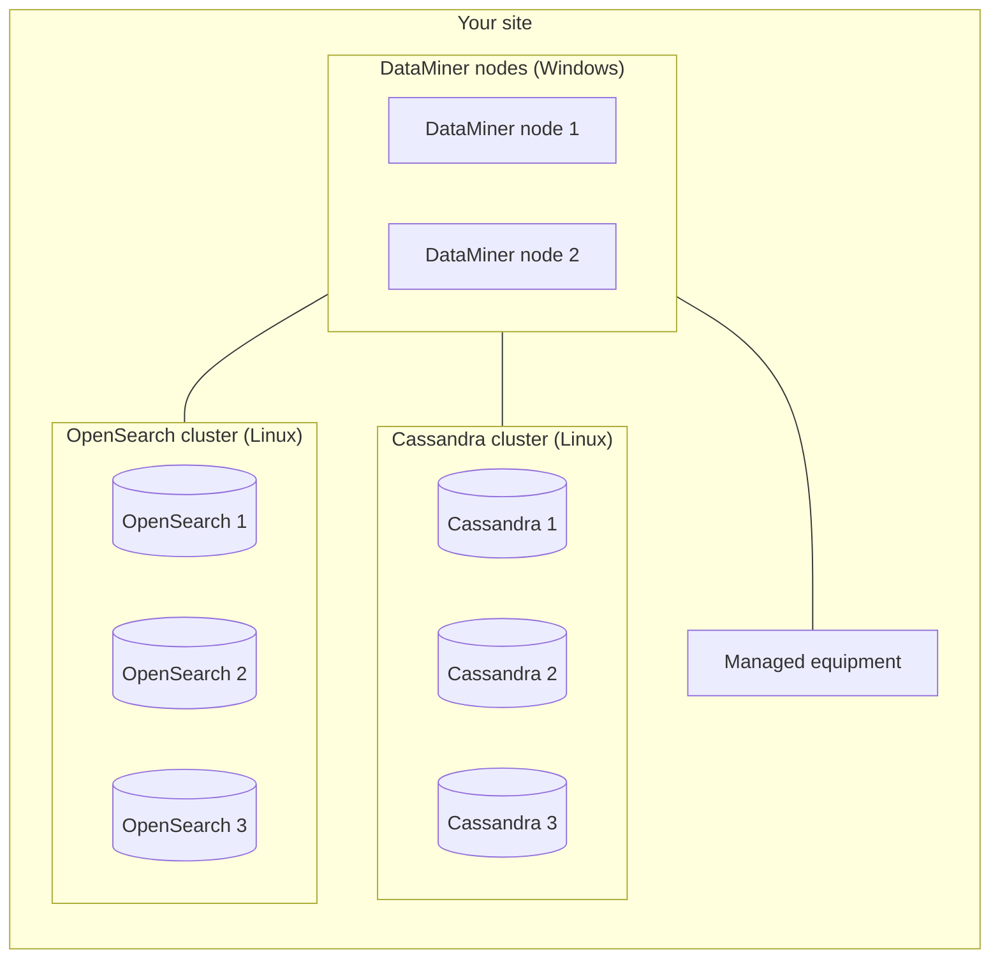

# On-premises system with self-managed storage

In this architecture, you host both the DataMiner nodes and the storage nodes yourself, typically at one site or in one data center. The storage consists of a [dedicated clustered storage](xref:Dedicated_clustered_storage) setup with a Cassandra cluster and an OpenSearch cluster.

> [!NOTE]
> Skyline recommends [Storage as a Service (STaaS)](xref:STaaS) for system data storage. Self-managed storage is supported, but it comes with additional effort and costs, such as hardware for the database nodes, database maintenance, and engineering services for the deployment of the database clusters. See [Self-managed DataMiner nodes and storage nodes](xref:DM_and_storage_selfhosted).

## When to use this architecture

This architecture is a good fit when:

- The network is isolated from the internet (air-gapped), or policy does not allow any connection to cloud services.
- Regulations or internal policies require that all data stays within your own premises.
- You have in-house expertise to operate Linux servers and Cassandra and OpenSearch clusters, or you have arranged this with a partner.

## Architecture

The recommended minimum setup for a redundant on-premises system consists of two DataMiner nodes, three Cassandra nodes, and three OpenSearch nodes, each on a dedicated machine:

The two DataMiner nodes can be configured as a [Failover](xref:failover) pair, or as two active nodes with [Swarming](xref:Swarming). As the system grows, you add DataMiner nodes and, depending on the load, database nodes. Use the [node calculator](https://community.dataminer.services/calculator/) to estimate the number of Cassandra nodes.

Smaller, non-critical systems sometimes use a single DataMiner node with a single Cassandra node and a single OpenSearch node. This setup has no redundancy at all: if any of the three machines fails, the system stops. It is mainly suitable for small or non-critical deployments and for [lab environments](xref:Architecture_lab_and_staging).

## Redundancy

- **Compute**: Use Failover pairs or multiple nodes with Swarming. See [Building blocks of a DataMiner System](xref:Architecture_building_blocks#redundancy-features).
- **Storage**: Use at least three Cassandra nodes with a suitable replication factor, and an OpenSearch cluster with an uneven number of nodes, at least three. With fewer nodes, the storage becomes a single point of failure: DataMiner cannot start if its storage is not available.
- **Infrastructure**: Spread the nodes over different physical hosts, power feeds, and storage systems. Virtual machines on a single hypervisor host or a single storage array share the same point of failure.

All nodes are located at one site, so this architecture does not protect against the loss of the complete site. For that, see [Geo-redundant on-premises system](xref:Architecture_geo_redundant).

## Maintenance and backups

Operating your own storage is the most demanding part of this architecture:

- You are responsible for installing, patching, and upgrading the operating systems, Cassandra, and OpenSearch, and for keeping them within the [supported versions](xref:Dedicated_clustered_storage).
- Cassandra requires regular maintenance, such as repairs, and monitoring of disk usage and compaction.
- Back up the databases separately from the DataMiner backups, using the native snapshot mechanisms of [Cassandra](xref:Cassandra_database) and OpenSearch. Schedule these backups close to the time of the DataMiner backup, so that the restore points match as closely as possible.
- Do not rely on virtual machine snapshots as the only backup of database nodes, as these do not guarantee a consistent state of a distributed database.
- Regularly test restoring a backup.
- In an air-gapped network, software updates for DataMiner, connectors, and the operating systems need to be transferred to the network manually, and features that depend on [dataminer.services](xref:Overview_dataminer_services) are not available.

## Pros and cons

| Pros | Cons |
|--|--|
| Works without any internet connectivity | Highest infrastructure and maintenance effort |
| Full control over data location and infrastructure | Requires database administration expertise for Cassandra and OpenSearch |
| No dependency on external services | You need to design, configure, and test the backups yourself |
| Low latency between all components at one site | Hardware for the database nodes needs to be sized and procured upfront |
| | Hybrid clusters with DaaS nodes are not supported |
| | No protection against the loss of the site |

## Commonly used in

- Government, defense, and public safety networks with strict isolation requirements.
- Critical infrastructure such as utilities, rail, and transport, where operational networks are separated from the internet.
- Broadcasters and satellite operators with isolated operational networks.
- Organizations with existing on-premises database operations teams.

See also [Architectures by market segment](xref:Architecture_market_segments).

## Sizing

Each DataMiner node, Cassandra node, and OpenSearch node must meet the [DataMiner Compute Requirements](xref:DataMiner_Compute_Requirements), which include separate requirements for the storage nodes. Run DataMiner, Cassandra, and OpenSearch on dedicated machines. Cassandra and OpenSearch run on Linux.

## Getting started

- [Dedicated clustered storage](xref:Dedicated_clustered_storage)
- [Before you begin to set up a new DMS](xref:Before_you_begin_to_set_up_a_new_DMS)
