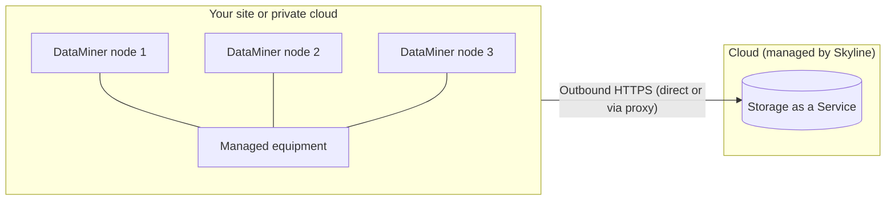

# Self-managed nodes with Storage as a Service

In this architecture, you host the DataMiner nodes yourself, on premises, in a private cloud, or in a public cloud, while the storage is provided by [Storage as a Service (STaaS)](xref:STaaS). This way, the DataMiner nodes can be placed close to the equipment they manage, while you do not need to install or maintain any database servers.

## When to use this architecture

This architecture is a good fit when:

- The equipment you want to manage is located in private networks at one or a few sites, and the DataMiner nodes need direct network access to it.
- Some devices need a physical or local connection, such as a serial connection.
- You already have a virtualization platform or server infrastructure that you want to use for the DataMiner nodes.
- The DataMiner nodes can make outbound HTTPS connections to the internet, directly or via a proxy.
- You want to avoid the effort of operating a Cassandra and OpenSearch cluster.

## Architecture

The number of DataMiner nodes depends on the size of the system and the redundancy model you choose. A single node is possible for small, non-critical systems.

## Redundancy

You can choose between two redundancy models for the DataMiner nodes:

- **[Failover](xref:failover)**: Each critical DMA is paired with a passive backup DMA at the same site, or at a nearby site with a low-latency connection. This gives a predictable active/passive takeover, but doubles the compute resources for every protected DMA.
- **[Swarming](xref:Swarming)**: All DMAs actively carry load. When a node fails or needs maintenance, its elements are moved to the other nodes. This requires spare capacity on the remaining nodes. [Node Recovery](xref:NodeRecovery_About) can automate this.

Failover and Swarming cannot be combined in the same DMS. See [Building blocks of a DataMiner System](xref:Architecture_building_blocks#redundancy-features) to compare them.

Storage redundancy is provided by STaaS, using zone-redundant storage by default or geo-redundant storage as an option.

> [!IMPORTANT]
> The DataMiner nodes need a working connection to STaaS. If the internet connection of a site is lost, the DMAs at that site can no longer read from or write to the storage. For critical systems, provide redundant internet connectivity and, where applicable, redundant proxies and firewalls.

## Maintenance and backups

- You maintain the DataMiner servers or virtual machines, including Windows updates, antivirus configuration, and hardware.
- Skyline maintains the storage platform. STaaS takes daily backups that are retained for 30 days.
- Configure [DataMiner backups](xref:Backing_up_a_DataMiner_Agent_in_DataMiner_Cube) to a location outside the DMA, such as a network share.
- With Swarming, you can carry out maintenance node by node with minimal downtime. With Failover, you can switch to the backup DMA before you carry out maintenance on the active DMA.

## Pros and cons

| Pros | Cons |
|--|--|
| DataMiner nodes are close to the managed equipment, with direct access to private networks and local interfaces | You need to maintain the DataMiner servers yourself |
| No database servers to install, size, patch, or back up | Requires outbound internet connectivity from every DMA |
| Storage scales automatically | Loss of internet connectivity affects the whole site |
| Can reuse existing virtualization platforms | DMZ setups are currently not supported with STaaS |
| Supports both Failover and Swarming | |

## Commonly used in

- Broadcasters and media service providers that monitor on-premises facilities such as master control rooms, playout centers, and transmission infrastructure.
- Satellite operators and teleports, where DataMiner nodes need local access to RF equipment, modems, and antenna control systems.
- Cable and telecom operators with equipment in headends and data centers.
- Organizations that have a virtualization platform but no in-house database administration expertise.

See also [Architectures by market segment](xref:Architecture_market_segments).

## Sizing

Each self-managed DataMiner node must meet the [DataMiner Compute Requirements](xref:DataMiner_Compute_Requirements). As STaaS is used, only the requirements for DataMiner itself apply. To estimate the storage cost, you can run a [STaaS cost estimation](xref:STaaS_cost_estimation) on an existing system.

## Getting started

- [Setting up STaaS](xref:Setting_up_StaaS)
- [Installing DataMiner](xref:Installing_DM_using_the_DM_installer)
