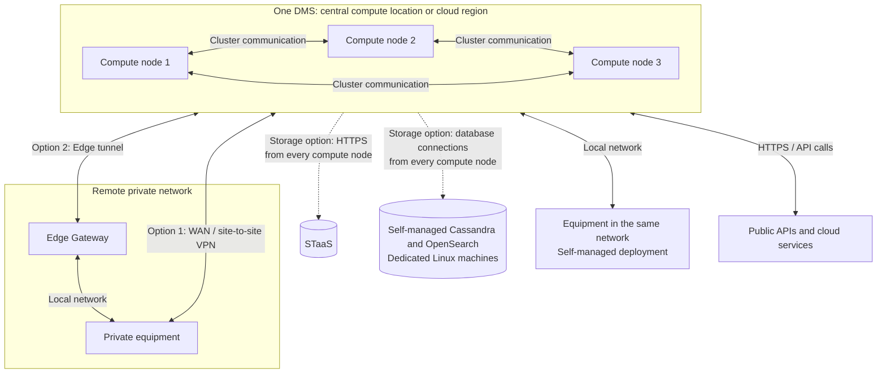

# Centralized cluster

A centralized cluster is the most common starting point for a multi-node DMS. It hosts compute at a central location or cloud region, with shared system data storage and one operational view. Integrations reach data sources directly, across a WAN or VPN, or through DataMiner Edge. The equipment does not need to be located alongside the cluster.

## When this topology fits

This topology is useful when you want one centrally operated system, need more capacity than one DMA, or need node redundancy. You do not need all of these reasons to apply. For example, a broadcaster may use a small redundant cluster for critical monitoring, while an EPM deployment may use many nodes to divide polling and aggregation workloads.

Centralized compute also fits private equipment at several sites if the connectivity and integration requirements can be met through a VPN or Edge. Where local integration execution is needed, consider Edge Nodes or a [distributed multi-site system](xref:Architecture_distributed_sites).

## Common use cases

- **Broadcast facilities**: One DMS monitors studios, playout, and the air chain, with centrally managed alarms and workflows.
- **Satellite and service-provider operations**: A network operations center manages teleport equipment or terminal populations through reachable device interfaces and vendor APIs.
- **Cloud media and OTT**: Integrations monitor encoders, streaming services, and cloud platforms from a shared compute environment.
- **Cable and telecom aggregation**: Multiple nodes divide polling, EPM aggregation, and user-facing workloads while remaining one system.
- **Shared orchestration**: Booking, resource management, and automation operate across private and cloud resources without requiring a separate system for each location.

For DaaS access to private sources, see [Connecting to private data sources](xref:Connecting_to_private_data_sources). The same topology can also run as a self-managed DMS.

## Arrangement

This example shows one DMS with centrally hosted compute and several ways to reach data sources. The three compute nodes illustrate a cluster, not a fixed minimum for every deployment. Dashed storage paths are alternatives: a DaaS DMS uses STaaS, while self-managed compute can use either storage option. Every compute node needs access to the chosen shared storage.

VPN and Edge Gateway paths represent alternative ways to reach remote equipment. The Gateway tunnels communication for integrations running on the central DMS; it is not a full DataMiner compute node. Use an Edge Node where compatible integrations should execute at the site instead.

Choose [hosting and storage](xref:Architecture_hosting_and_storage) independently of this arrangement. DaaS uses STaaS. Self-managed nodes can use STaaS or dedicated clustered storage, on premises or in a cloud environment.

As the system grows, you can separate user-facing functions from polling or aggregation workloads. All nodes remain part of one DMS, so configuration and upgrades stay coordinated. This reduces the need for cross-system integration, but means changes and shared dependencies can affect the whole system.

## Redundancy and maintenance

Multiple nodes alone do not guarantee takeover. Use [Swarming](xref:Swarming) to move supported workloads across active nodes, with sufficient capacity and reachability for recovery. Global Node Recovery detection requires at least three nodes; two-node recovery can use local detection with additional network-split risks. See [Node Recovery detection](xref:NodeRecovery_Detection) before relying on automatic redistribution.

Provide storage redundancy as well as compute redundancy. Place redundant nodes in separate failure domains, rather than on the same physical host or storage array. A cluster at one location does not by itself withstand loss of that location; apply a [geo-redundant design](xref:Architecture_geo_redundant) if that is required.

Central polling depends on the connection to each remote site. Edge Nodes can place integrations locally, but do not replace an independent full DMS where a site must operate in isolation. Include WAN interruptions in recovery testing.

## Sizing and operations

Size compute and any self-managed databases using the [DataMiner Compute Requirements](xref:DataMiner_Compute_Requirements). Keep capacity for the chosen recovery model, not just normal operation.

For a self-managed DMS, coordinate platform upgrades across the cluster and configure DataMiner backups alongside the storage backup strategy. Skyline manages DaaS maintenance and backups; see [Hosting and storage](xref:Architecture_hosting_and_storage). Develop and validate solution changes in [lab and staging](xref:Architecture_lab_and_staging#promoting-changes-to-production), promoting the same tested package version to production.
