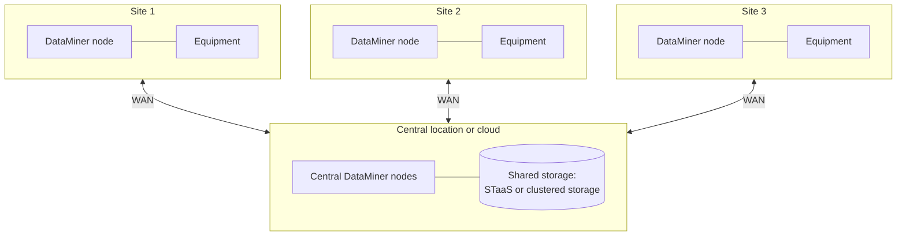

# Distributed multi-site system

In this architecture, one DataMiner System manages equipment at several locations, such as regional TV stations, headends, teleports, transmitter sites, or train stations. You get one operational view while placing integrations or DataMiner nodes close to the equipment where needed. The system can use cloud-hosted or on-premises compute, with managed or self-managed storage according to its connectivity requirements.

This arrangement keeps site data in one operational system and lets you add locations gradually. Its suitability depends on the links and the amount of processing needed at each site, not on a fixed minimum number of locations.

## When to use this architecture

One or more of the following may make this topology a good fit; you do not need to meet all of them:

- You manage equipment spread over many sites, and you want to operate it from one or more central operations centers.
- Local interfaces or polling volumes make it useful to run integrations near the equipment.
- Some sites need local data collection during interruptions, using a supported Edge integration or a deliberately independent system where required.

Reliable cluster and storage connectivity remains a prerequisite for sites hosting full DMAs. For independently operational sites, see [Multiple independent DataMiner Systems](xref:Architecture_multiple_systems).

## Architecture variants

There are several ways to collect data from remote sites. They can be combined within one system.

### DataMiner nodes at the sites

A site can host a full DataMiner node when it needs local DataMiner functionality or workloads that are not covered by Edge. All nodes are part of one DMS and share the same storage. A full DMA is not required merely because the site is remote.

- Polling traffic stays within the site, which reduces WAN traffic and allows local interfaces such as serial connections.
- With [Storage as a Service](xref:STaaS), each site needs outbound internet access. With self-managed storage, each node needs a reliable, low-latency connection to the central database clusters.
- Every node is a full DataMiner Agent that needs to be maintained and upgraded.

### Central polling over the WAN

Smaller sites have no local DataMiner node. The equipment is polled directly from the central DataMiner nodes over the WAN, a VPN, or a [DataMiner Edge Gateway](xref:About_Edge_Gateways).

- Fewer servers to maintain.
- Monitoring of a site stops when the connection to the site is lost. However, the loss of connectivity itself is detected and reported centrally.
- Suitable for sites with a limited number of devices and a stable connection.

### DataMiner Edge Nodes

An [Edge Node](xref:About_Edge_Nodes) runs compatible Python-based integrations locally and forwards their data to elements in the central system. During a connection interruption, it buffers collected data on disk and synchronizes it when connectivity returns. This provides local execution with a smaller footprint than a full DMA, but does not provide an independent complete DataMiner System. Edge Nodes are currently available in preview.

## Redundancy

- **Central functions**: Apply the [centralized cluster](xref:Architecture_centralized_cluster) redundancy guidance, and add a [geo-redundant design](xref:Architecture_geo_redundant) if the operation must withstand loss of the central hosting site.
- **Sites**: Decide per site whether local redundancy is required. A DMS can have multiple compute nodes at critical sites and use Swarming for supported workloads, provided the recovery nodes can reach the equipment. Less critical sites may need only one compute node or an Edge component.
- **WAN**: Do not cluster DataMiner nodes that depend on each other over unreliable WAN links. Design each site so that a WAN failure only affects the visibility of that site, not the rest of the system.

### What happens when a site loses its connection

Distinguish the loss of the link to central compute from the loss of a site's storage connection. Neither a local DMA nor an Edge Node automatically guarantees all local alarms, control, and workflows during an outage.

| Site setup | Data collection at the site | Central visibility of the site |
|--|--|--|
| Full DMA at the site | Local equipment access does not remove the dependency on shared storage or other cluster functions. Test which operations remain available for the specific failed network path. | Updates from an unreachable site cannot be relied on until connectivity returns. |
| Central polling, directly or through an Edge Gateway | Central polling cannot reach the equipment while its only connection is unavailable. | Live data from that path is unavailable during the interruption. |
| Edge Node with compatible integrations | Collected data is buffered on disk and synchronized after reconnection. This is data-collection continuity, not independent central alarms or control. | New data reaches the DMS after connectivity returns. |

If a site must remain fully operational in isolation, consider a separate DMS with a storage and connectivity design that supports that requirement. Validate polling, alarms, control, historical storage, and reconnection against the actual failure scenario rather than assuming a local node guarantees them.

## Maintenance and backups

- All compute nodes in one DMS run the same DataMiner version. For self-managed compute, plan enough bandwidth and maintenance windows to reach every site. Skyline manages DaaS platform maintenance.
- For the self-managed parts of a DMS, configure [DataMiner backups](xref:Backing_up_a_DataMiner_Agent_in_DataMiner_Cube) outside the compute hosts. Skyline manages [DaaS backups](xref:Creating_a_DaaS_system_FAQ#what-backup-policy-does-a-daas-system-have).
- Keep an inventory of which elements run on which site, and use views and naming conventions per site to keep the system manageable.

## Commonly used in

- Broadcasters with a network of regional stations, studios, or transmitter sites.
- Cable and telecom operators with many headends, hubs, or central offices.
- Satellite operators with multiple teleports and gateway sites.
- Rail, transport, and utility networks with many stations or substations.

See also [Architectures by market segment](xref:Architecture_market_segments).

## Sizing

Size each site node based on the number of elements and the load at that site, according to the [DataMiner Compute Requirements](xref:DataMiner_Compute_Requirements). Small sites with few elements may not need a dedicated node.
