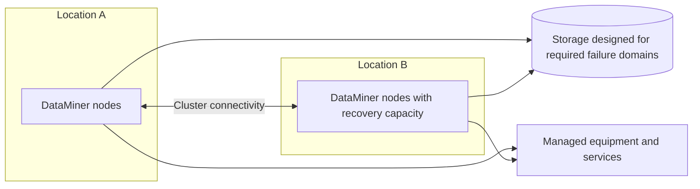

# Geo-redundant system

A geo-redundant design places compute at separate locations so a system can recover when a complete hosting site is lost. This can extend a centralized cluster or a distributed system. It is not limited to on-premises deployments: hosting may be cloud-based, self-managed, or a supported hybrid arrangement.

## When this topology fits

Site-loss continuity is the main reason to choose this topology. Examples include a broadcaster with a main and backup operational center, a satellite operator with two teleports, or an operation whose recovery target cannot depend on rebuilding the only hosting site. You do not need to match every example.

Recovery requires more than geographically separated machines. Remaining compute must have capacity, supported takeover mechanisms, access to storage, and access to the devices and services it must manage. If locations must operate independently or cannot meet cluster connectivity requirements, consider [separate systems](xref:Architecture_multiple_systems) instead.

## Compute and storage placement

Place DataMiner nodes at both locations and choose [Failover or Swarming](xref:Architecture_building_blocks#redundancy-features) according to the objects and recovery behavior you need. Swarming requires spare capacity and reachable data sources; global outage detection in Node Recovery also has cluster-size and leader-election prerequisites. Geographical placement alone does not guarantee automatic recovery.

### With STaaS

STaaS provides zone-redundant storage by default and optional geo-redundant storage (GRS) with a copy in a paired region. This separates the database operations from your compute placement. Select the storage option against your recovery targets using [Data location and redundancy](xref:STaaS_features#data-location-and-redundancy).

GRS does not provide a replacement DMA or reconnect managed equipment. Nodes at the surviving location must still reach STaaS and all required sources. For multi-region DaaS compute, consult the [DaaS regional guidance](xref:DaaS_hosting#regional-support-for-daas) and agree the supported design with Skyline.

### With self-managed databases

For a geo-redundant on-premises deployment, configure Cassandra with a data center per site and an appropriate NetworkTopologyStrategy. OpenSearch uses data nodes at both sites and a non-data tie-breaker node at a third location, with shard allocation awareness. The tie-breaker provides an additional voting location so the cluster can retain a majority after losing a site.

This arrangement gives control over data placement but makes database maintenance and network partitions part of your recovery design. See [Failover setups with geo-redundancy](xref:Dedicated_clustered_storage#failover-setups-with-geo-redundancy) for the detailed setup and minimum configuration.

## Network requirements

Follow the [DataMiner inter-node requirements](xref:DataMiner_Compute_Requirements#network) for latency and throughput, and verify reachability from every recovery node. Self-managed OpenSearch nodes require a stable low-latency link between sites; they must not simply be stretched across high-latency connections. A cloud-hosted tie-breaker requires sufficiently low latency, below 50 ms.

These are different network paths: acceptable DataMiner inter-node latency does not automatically prove that a distributed database design is suitable. Measure the actual links and validate the design before deployment.

## Recovery and operations

Define how much downtime and recent data loss are acceptable, then test node loss, site loss, and network partitions separately. Replicated storage is not a substitute for backups, and a replicated copy does not by itself guarantee zero data loss.

For self-managed storage, coordinate repairs and upgrades across sites and test loss of each voting location. For STaaS, understand the selected service's redundancy and recovery behavior rather than assuming a storage-region failure and a compute-site failure are identical.

Size each surviving compute location for the workload it must absorb using the [DataMiner Compute Requirements](xref:DataMiner_Compute_Requirements). Store backups outside the failure domain they protect. See [Hosting and storage](xref:Architecture_hosting_and_storage#redundancy-and-backups) for responsibilities and backup guidance.
