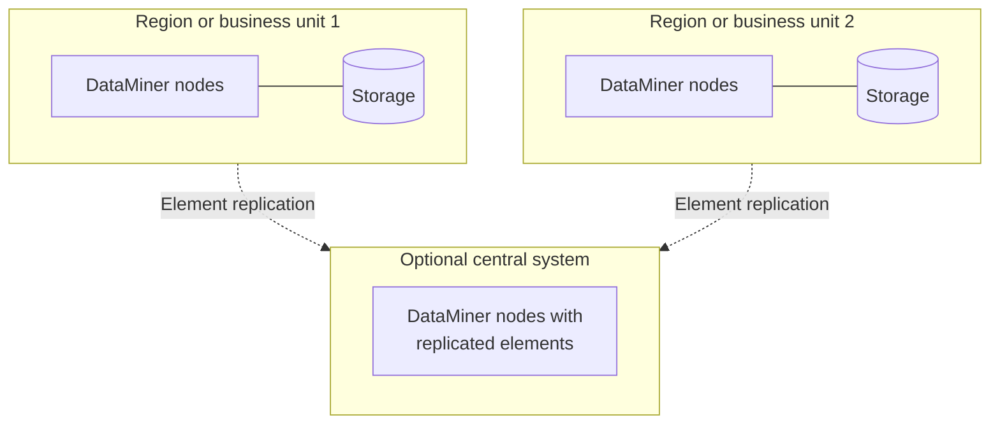

# Multiple independent DataMiner Systems

Instead of one DataMiner System that covers everything, you can deploy several independent systems, for example one per region, business unit, or security zone. Each system has its own nodes and storage, and can be hosted on premises or in the cloud.

This arrangement makes sense when independence is part of the requirement. Each system can have its own change process and failure domain, while a central view can share selected information. Unlike extending one cluster, it requires separate configuration, backups, and upgrades, so plan how to prevent configuration drift and which information should cross the boundaries.

## When to use this architecture

Any of the following can justify independent systems; they are alternatives, not requirements that must all apply:

- **Distance**: Sites or users are spread over different continents. One cluster with storage in one region would lead to high latency for some of them, and a single self-managed OpenSearch cluster cannot be stretched over long distances.
- **Organization**: Different business units or teams have their own operations, change processes, and upgrade schedules.
- **Security zones**: Networks are strictly separated, for example an operational technology network and a corporate network, or networks of different customers in a managed service.
- **Data residency**: Data of different regions must be stored in different jurisdictions. As each DMS uses one storage region, separate systems allow you to keep each region's data in its own location.
- **Blast radius**: You want to limit the impact of a failure, an upgrade, or a configuration error to one part of the organization.

## Architecture

Each system can use a [single agent](xref:Architecture_single_agent), a [centralized cluster](xref:Architecture_centralized_cluster), or a [distributed topology](xref:Architecture_distributed_sites), and can add geo-redundancy as needed. Choose [hosting and storage](xref:Architecture_hosting_and_storage) per system: one region may use DaaS and STaaS, while an isolated operational network uses on-premises compute and databases.

## Sharing information between systems

If you need a central view across systems, you have several options:

- **[Element replication](xref:Replicated_elements)**: An element from one DMS is shown in another DMS, with its parameter values and alarms. This is suitable for a limited number of key elements, such as a summary or aggregation element per system. The source and destination DMA must use the same DataMiner version, and the replicating DMS must be able to reach the source DMS (gRPC on port 443 or .NET Remoting on port 8004).
- **Dashboards and APIs**: Combine data from several systems in dashboards or external tools, for example via [dataminer.services](xref:Overview_dataminer_services) or APIs.
- **Manager of managers**: A central DataMiner System monitors the other systems in the same way it monitors any other data source, for example via connectors or alarm forwarding.

Each of these options adds connections and dependencies between the systems. Keep the integration as simple as possible.

## Redundancy

Each system has its own redundancy design. Separation limits direct dependencies, but shared infrastructure and cross-system integrations may still create common failure points. Central views depend on the availability and connectivity of the source systems.

## Maintenance and backups

- Each system needs its own maintenance, upgrades, backups, and monitoring.
- When you use element replication, keep the DataMiner versions of the systems aligned.
- Keep configurations such as connectors, alarm templates, and Automation scripts consistent across systems, for example via the [Catalog](xref:About_the_Catalog_app) or a CI/CD process.

## Commonly used in

- International media groups and service providers with operations on several continents.
- Telecom and cable operators that keep separate systems for different networks or technology domains.
- Managed service providers that run separate systems for different customers.
- Government and defense organizations with strictly separated networks.

See also [Architectures by market segment](xref:Architecture_market_segments).
