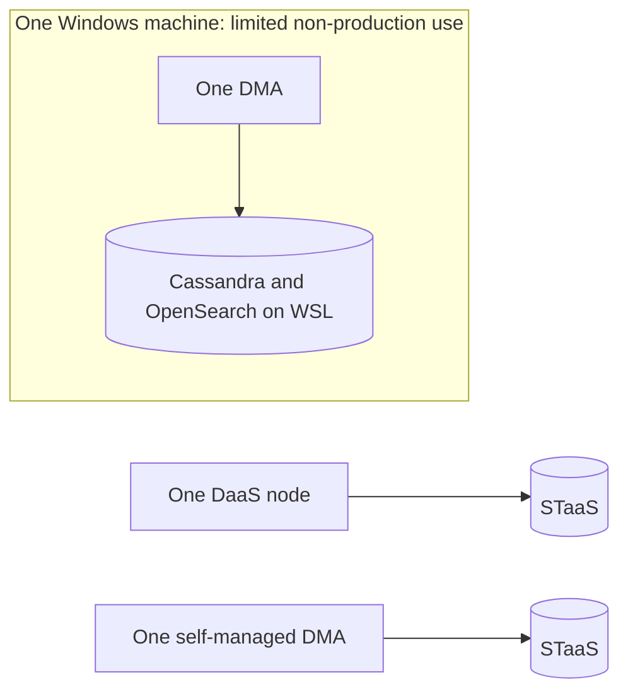

# Single-agent system

A single-agent system places the DataMiner workload on one DMA. It is the smallest compute topology and gives you one node to configure and operate. Hosting and storage determine the local footprint: one DaaS node needs no DataMiner server on your premises, while a self-managed DMA with STaaS needs one Windows server or virtual machine but no local database servers.

## When this topology fits

You may choose this topology because your workload fits one node, you are evaluating DataMiner, or your operation can tolerate the node being unavailable during maintenance or recovery. These are examples, not cumulative requirements. A small production system can use this topology if its availability requirements permit it.

The data sources can be public APIs, private equipment, or a combination. A DaaS node can reach private sources through a site-to-site VPN or DataMiner Edge; a self-managed node can use direct local access or the same remote connectivity options.

## Deployment variations

Choose one of these variations:

- **DaaS with STaaS**: Skyline operates the compute infrastructure and storage. You configure the system and provide a supported path to your data sources.
- **Self-managed DMA with STaaS**: You operate the Windows machine and Skyline operates storage. This suits an existing server platform or a requirement to place the DMA locally. Outbound HTTPS to STaaS is required.
- **Self-managed DMA with local WSL databases**: Cassandra and OpenSearch run locally on Windows Subsystem for Linux. This reduces the number of machines, not the combined resource requirements or maintenance responsibilities. Use the [pre-installed DataMiner Virtual Hard Disk](xref:Using_a_pre_installed_DataMiner_Virtual_Hard_Disk) and follow its platform-specific restrictions. The local-storage setup is intended for small test, development, and staging environments, not normal production use.

For WSL, provide resources for DataMiner and both database components, and enable nested virtualization where required by the VHD instructions. See [DataMiner Compute Requirements](xref:DataMiner_Compute_Requirements) and [Single DMA storage setups](xref:Dedicated_clustered_storage#single-dma-setups).

## Availability and growth

One DMA has **no compute redundancy**. STaaS provides storage redundancy, but does not take over a failed DMA. With local WSL storage, compute and databases share the same machine, so a host failure affects both. Plan downtime for maintenance and test your restore procedure.

If the load outgrows one node, move to a [centralized cluster](xref:Architecture_centralized_cluster). If availability becomes critical, add an appropriate redundancy model even if the workload still fits one DMA. A local WSL deployment that grows beyond its intended scope needs migration to STaaS or dedicated storage and [decommissioning of WSL](xref:Decommissioning_WSL).

## Operations and getting started

Configure [DataMiner backups](xref:Backing_up_a_DataMiner_Agent_in_DataMiner_Cube) and keep them outside the node. STaaS provides daily storage backups retained for 30 days; with local databases, you must arrange database backups as well.

For DaaS, start with [Creating a DMS on dataminer.services](xref:Creating_a_DMS_on_dataminer_services). For a self-managed node with STaaS, use the [DataMiner installer](xref:Installing_DM_using_the_DM_installer) and [STaaS setup instructions](xref:Setting_up_StaaS). Compare costs using the [DaaS sizing guide](xref:Pricing_sizing_guide_services_DaaS) and [STaaS sizing guide](xref:Pricing_sizing_guide_services_StaaS).
