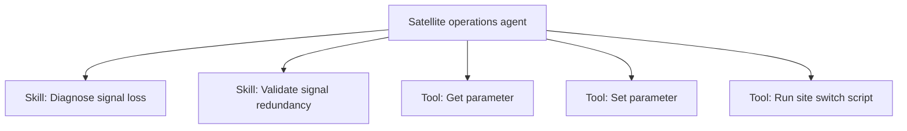

# Designing agents, skills, and tools

This page provides guidance for designing [agents](xref:Intelligence_Assistant_Agents), [skills](xref:Intelligence_Assistant_Skills), and [tools](xref:Intelligence_Assistant_Tools) in DataMiner Intelligence. The boundary between these concepts is not primarily technical. It is about ownership, autonomy, context, and delegation.

## Core principle

Use the smallest concept that can own the responsibility.

| Concept | Purpose | Example |
|---------|---------|---------|
| Tool | An atomic capability or interaction | Get a parameter, set a parameter, run a script |
| Skill | Reusable expertise or procedure that uses one or more tools | Diagnose signal loss, schedule a downlink |
| Agent | Autonomous owner of a business or operational domain | Satellite operations agent, booking and scheduling agent |

A simple mental model:

- Tools are capabilities.
- Skills are expertise.
- Agents are ownership.

Avoid creating a separate agent just because a reusable function exists, such as "get service", "query alarms", or "schedule workflow". Those belong in tools or skills.

## When to create a separate agent

Create a separate [specialized agent](xref:Intelligence_Assistant_Specialized_Agents) when there is a clear boundary of responsibility. A separate agent is appropriate when:

- It represents a distinct business or operational domain with its own goals.
- A user could reasonably ask it to solve a problem independently.
- It requires substantially different context, instructions, or expertise.
- It has its own tools and data sources.

Keep it as a **skill** when it is primarily a reusable procedure or reasoning pattern. Keep it as a **tool** when it is a single atomic action or data operation.

> [!TIP]
> You do not need a specialized agent for every use case. The [native agents](xref:Intelligence_Assistant_Agents#native-agents) are intended to answer general questions about the data in your DataMiner System. Specialized agents are useful when you need to narrow the scope or add specialized domain context, for example for a particular network segment.

## Avoid fragmentation

Do not create an agent for every capability. For example, avoid creating a separate alarm agent, parameter agent, workflow agent, scheduling agent, and topology agent when these capabilities belong to the same operational domain. Splitting them up makes the setup harder to maintain, debug, and secure.

Instead, group related capabilities under a single domain agent, using skills and tools underneath it.

At the same time, avoid the opposite extreme: a single agent that is expected to do anything in DataMiner. An agent like this accumulates an oversized set of instructions, ambiguous tool selection, conflicting guidelines, and unclear responsibility. Prefer a limited number of focused domain agents over one universal agent.

## Start small

Start with a single agent, and add skills and tools underneath it. Introduce a separate agent only when a meaningful responsibility boundary emerges.

When you add context to an agent, keep the following in mind:

- Put substantial context that is only relevant in certain situations in a skill, even if only one agent uses it. The skill is only loaded when needed, which keeps the agent focused and reduces the context sent by default.
- Assign only the tools and skills an agent needs. A specialized agent only has access to the references assigned to it.
- If a skill refers to specific tools in its instructions, also add those tools as references to the agent.

## Example: ticketing

DataMiner is used across multiple operational domains, such as broadcast operations, satellite operations, and network operations. All of these domains may need to create and update tickets. Whether ticketing needs its own agent depends on the responsibility assigned to it.

- **Ticketing as tools and skills**: If ticketing is mainly used for create, read, update, and delete operations, a separate ticketing agent is not necessary. Each operational agent can use tools such as *create ticket* and *update ticket*, or a skill such as *summarize ticket history* when more reasoning is involved.

- **Dedicated ticketing agent**: A separate ticketing agent becomes relevant when it owns the entire ticket lifecycle. This includes tracking tickets, re-evaluating open tickets, detecting tickets that are no longer progressing, escalating tickets, and checking that an issue is really resolved before a ticket is closed.

As a rule, if ticketing is simply something an operational agent does, provide it as tools and skills on that agent. If ticketing itself requires ongoing monitoring, escalation, and follow-up across domains, make it a separate agent. This applies to other DataMiner capabilities as well: do not create an agent because a module exists, but because the module represents an independent responsibility.
