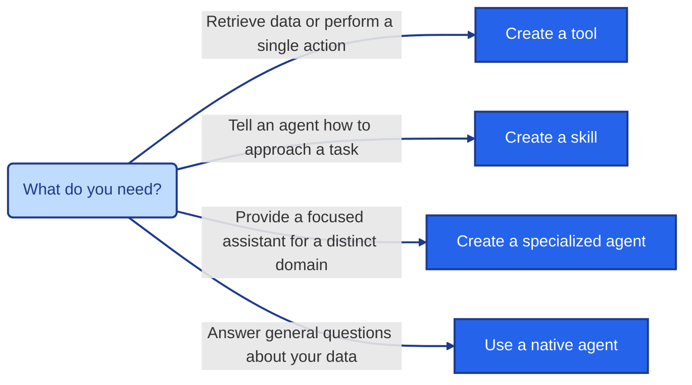

# DataMiner Intelligence FAQ

## About DataMiner Intelligence

### What is DataMiner Intelligence, and what is the DataMiner Assistant?

DataMiner Intelligence is the overarching term for the AI-powered capabilities delivered by the DataMiner Assistant DxM. These capabilities include agents, skills, and tools, as well as features such as [Document Intelligence](xref:docintel) and [natural language to GQI](xref:Intelligence_NL2GQI). They use Large Language Models (LLMs) to help you retrieve and interpret information, create queries, and perform guided actions.

The DataMiner Assistant is the conversational interface to DataMiner Intelligence. For an overview, see [About DataMiner Intelligence](xref:DataMiner_Intelligence).

### Does DataMiner Intelligence support languages other than English?

Yes. The underlying models are multilingual and respond in the language used in the question.

### Can DataMiner Intelligence answer questions that require DataMiner context?

Yes. Agents can handle questions that require DataMiner context, such as retrieving data across many elements, identifying the worst performer, or filtering alarms for a specific view. What an agent can answer depends on the available native and custom tools, skills, your permissions, and the quality of the data in your system.

Use cases that require explicit knowledge of your environment, for example diagnosing the cause of a specific type of network failure based on alarm patterns and traffic shifts, will likely require a specialized agent with the necessary instructions and skills.

## Agents, skills, and tools

### What is the difference between agents, skills, and tools?

- **Agents** interpret requests and decide how to investigate or act.
- **Skills** provide agents with domain-specific workflows, instructions, and resources.
- **Tools** let agents query data or run explicitly assigned actions, such as GQI data queries or automation scripts.

When deciding what to create, start with the smallest concept that can do the job:

Avoid creating a separate agent just because a reusable function exists, such as "get service" or "query alarms". Those are tools or skills.

For more information, see [Agents](xref:Intelligence_Assistant_Agents), [Skills](xref:Intelligence_Assistant_Skills), and [Tools](xref:Intelligence_Assistant_Tools).

### Do I need a specialized agent for every use case?

No. The [native agents](xref:Intelligence_Assistant_Agents#native-agents) are intended to answer general questions about the data in your DataMiner System without requiring separate agents. [Specialized agents](xref:Intelligence_Assistant_Specialized_Agents) are useful when you need to narrow the scope or add specialized domain context, for example for a particular network segment.

### When should I create a specialized agent instead of a skill or tool?

Create a specialized agent when:

- It represents a distinct business or operational domain with its own goals.
- Users could reasonably ask it to solve a problem independently.
- It requires substantially different context, instructions, or expertise than the native agents.
- It needs its own set of tools and data sources.

If a capability is mainly a reusable procedure, make it a skill. If it is a single action or data operation, make it a tool.

Keep the following in mind:

- **Start small.** Start with one agent and add skills and tools to it. Only introduce a separate agent when a clear responsibility boundary emerges.
- **Do not create an agent per capability.** If all capabilities belong to the same operational domain, group them in one domain agent with the relevant skills and tools.
- **Do not create one agent that does everything.** An agent that is expected to handle anything in DataMiner ends up with oversized instructions, ambiguous tool selection, and conflicting guidelines.
- **Assign only what the agent needs.** A specialized agent only has access to the tools and skills assigned to it. If a skill refers to specific tools in its instructions, also add those tools to the agent.

### Can one agent delegate a task to another agent?

No. DataMiner Intelligence agents cannot currently delegate tasks to one another. To cover an end-to-end workflow, assign the required tools and skills to a single specialized agent.

### Should a capability that is only used by one agent still be implemented as a skill?

Often, yes. When context is substantial and only relevant in certain situations, putting it in a skill is preferable, even if only one agent uses it. The skill is only loaded when needed, which keeps the agent focused and reduces the context sent by default.

### What is the best way to make documentation available to agents?

The simplest approach is to create one [skill](xref:Intelligence_Assistant_Skills) with multiple resource files. Organize the documentation as text-based files in the skill folder or in nested subfolders, and reference each resource explicitly in the skill instructions. Specify each path relative to the skill folder, including every nested folder. Agents will load the resources progressively when they are relevant.

For the supported folder structure and `SKILL.md` requirements, see [Using skill files](xref:Intelligence_Assistant_Skills#using-skill-files).

### Why must script input descriptions be defined in the script tool?

Agents use the descriptions defined in the [script tool](xref:Intelligence_Assistant_ScriptTools) to understand how to interact with the script, which values to provide, and how to validate user input. This ensures that each tool has consistent, AI-friendly metadata, regardless of how the underlying script is documented.

The description will generally be the same for a given script, but defining it in the script tool also allows the same script to be used in different operational contexts. Multiple tools can provide different instructions, examples, or validation requirements without modifying the underlying script.

## Access and setup

### Do I need to install the DxM on every DataMiner Agent in the cluster?

No. Install the DataMiner Assistant DxM on a few suitable Agents to provide redundancy. The installation and configuration only have to be performed on the Agents that host the DxM.

Do not install the DxM on a Failover pair. Failover configurations are not supported, and script tools cannot run automation scripts when the DxM is hosted on a Failover Agent.

### Is installation required on a DaaS system?

For DaaS systems running DataMiner 10.6 or newer, no installation is needed. The DataMiner Assistant DxM is already installed and running. To request access to the Assistant app or preview capabilities, contact [ai@skyline.be](mailto:ai@skyline.be).

### Why is the Assistant app not visible?

Ask your DataMiner administrator to confirm that the DataMiner Assistant DxM is running and that the app is available in your System. To request preview access, or if the app remains unavailable, contact [ai@skyline.be](mailto:ai@skyline.be).

### Why can I view an agent, skill, or tool but not edit it?

Viewing agents, skills, and tools does not require the same permissions as managing them. Creating or editing them requires the [Modules > System configuration > Tools > Admin tools](xref:DataMiner_user_permissions#modules--system-configuration--tools--admin-tools) user permission. The *Agents* page is only available if specialized agents have been made available in your system.

### Do specialized agents provide a separate security boundary?

No. Assigning tools and skills defines an agent's capabilities, but does not create an agent-specific permission boundary. Continue to manage access through your DataMiner user permissions. For more information, see [Data privacy and security](xref:Intelligence_Data_Privacy_Security).

### Where can I find the DataMiner Assistant DxM version?

In the DataMiner web apps, click the user icon in the top-right corner and select *About*. The version of the DataMiner Assistant DxM is listed as *Assistant*, together with the versions of the other DataMiner components.

### Does adding a new model require a new DxM version?

Not always. Newer models that use the same APIs can be made available automatically. Adding a new model provider does require a DxM upgrade.

## Performance and supported functionality

### How does DataMiner Intelligence handle very large datasets?

DataMiner Intelligence normally limits raw data sent directly to the LLM to approximately 100 rows. For larger datasets, it can export the data to a CSV file and provide metadata and a sample so that Python can analyze the full dataset in a cloud execution environment or sandbox.

### How are data queries executed and scaled?

Tool execution and data fetching are load-balanced across the DataMiner Agents in the cluster.

DataMiner Intelligence uses GQI to fetch data efficiently. GQI uses bulk parameter fetching, paging, and optimized query lifecycles to reduce the impact on DataMiner System operations. Queries are load-balanced across DataMiner Agents through the NATS message broker, which supports scalability and resilience.

Queries on very large tables can be expensive. In that case, we recommend using targeted filtering, for example through custom skills.

### What is the current EPM capability?

EPM support is currently limited. EPM chains are not yet supported, and relational table data that is important for EPM is still being developed. Existing skills and tools can provide the data you need in the interim. You can create custom skills to optimize filtering for large collector-table queries.
