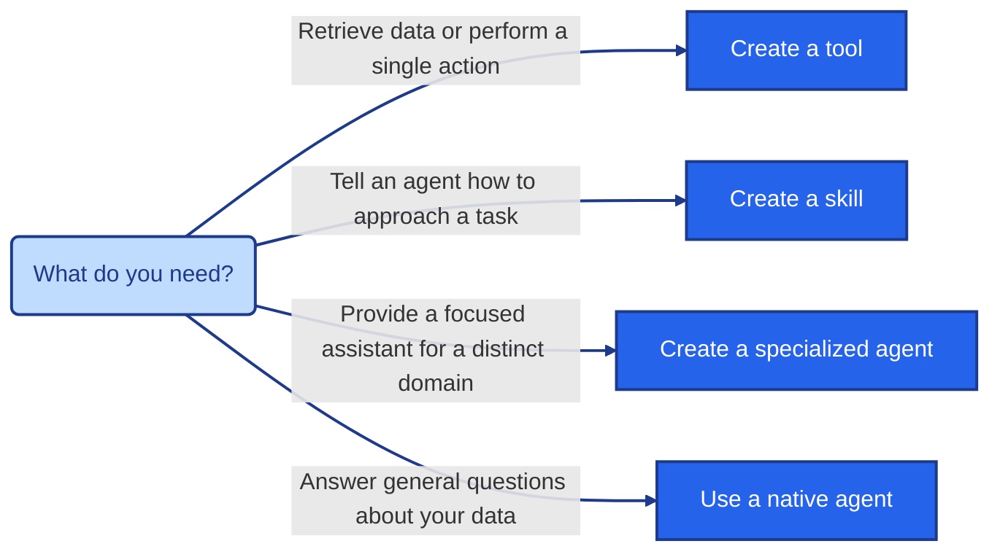

# DataMiner Intelligence FAQ

## About DataMiner Intelligence

### What is DataMiner Intelligence, and what is the DataMiner Assistant?

DataMiner Intelligence is the umbrella term for AI capabilities in DataMiner. It includes the agent framework, with agents, skills, and tools, and capabilities such as [Document Intelligence](xref:docintel) and [natural language to GQI](xref:Intelligence_NL2GQI).

DataMiner Assistant is the name for the chat integrations that let you interact with DataMiner Intelligence agents, including the [DataMiner Assistant app](xref:Intelligence_Assistant_app) and [DataMiner Assistant for Microsoft 365](xref:Intelligence_Assistant_M365). The [DataMiner Assistant module](xref:DataMinerCoreModules#assistant) powers both the agent framework and the non-chat capabilities. For an overview, see [About DataMiner Intelligence](xref:DataMiner_Intelligence).

### Does DataMiner Intelligence support languages other than English?

Yes. When you chat with an agent in DataMiner Assistant, the underlying model can respond in the language you use to ask the question.

### Can DataMiner Intelligence answer questions that require DataMiner context?

Yes. Agents can handle questions that require DataMiner context, such as retrieving data across many elements, identifying the worst performer, or filtering alarms for a specific view. What an agent can answer depends on the available native and custom tools, skills, your permissions, and the quality of the data in your system.

Use cases that require explicit knowledge of your environment, for example diagnosing the cause of a specific type of network failure based on alarm patterns and traffic shifts, will likely require a specialized agent with the necessary instructions and skills.

## Agents, skills, and tools

### What is the difference between agents, skills, and tools?

- **Agents** are autonomous systems that sense their environment, process input to make decisions, and take actions to achieve a specific goal.
- **Skills** are specialized knowledge sets or procedural instruction workflows that enable AI to handle specific tasks step by step.
- **Tools** are external functions that allow AI to interact directly with DataMiner.

When deciding what to create, start with the smallest concept that can do the job:

Avoid creating a separate agent just because a reusable function exists, such as "get service" or "query alarms". Those are tools or skills.

For more information, see [Agents](xref:Intelligence_Agents), [Skills](xref:Intelligence_Skills), and [Tools](xref:Intelligence_Tools).

### Do I need a specialized agent for every use case?

No. The [native agents](xref:Intelligence_Agents#native-agents) are intended to answer general questions about the data in your DataMiner System without requiring separate agents. [Specialized agents](xref:Intelligence_Specialized_Agents) are useful when you need to narrow the scope or add specialized domain context, for example for a particular network segment.

### When should I create a specialized agent instead of a skill or tool?

Create a specialized agent when:

- It represents a distinct business or operational domain with its own goals.
- Users could reasonably ask it to solve a problem independently.
- It requires substantially different context, instructions, or expertise than the native agents.
- It needs its own set of tools and data sources.

If a capability is mainly a reusable procedure, make it a skill. If it is a single action or data operation, make it a tool.

Keep the following in mind:

- **Start small.** Start with one agent and add skills and tools to it. Only introduce a separate agent when a clear responsibility boundary emerges.
- **Do not create an agent per capability.** If all capabilities belong to the same operational domain, group them in one domain agent with the relevant skills and tools.
- **Do not create one agent that does everything.** An agent that is expected to handle anything in DataMiner ends up with oversized instructions, ambiguous tool selection, and conflicting guidelines.
- **Assign only what the agent needs.** A specialized agent only has access to the tools and skills assigned to it. If a skill refers to specific tools in its instructions, also add those tools to the agent.

### Can one agent delegate a task to another agent?

No. DataMiner Intelligence agents cannot currently delegate tasks to one another. To cover an end-to-end workflow, assign the required tools and skills to a single specialized agent.

### Should a capability that is only used by one agent still be implemented as a skill?

Often, yes. When context is substantial and only relevant in certain situations, putting it in a skill is preferable, even if only one agent uses it. The skill is only loaded when needed, which keeps the agent focused and reduces the context sent by default.

### What is the best way to make documentation available to agents?

For a small documentation set, create a skill with companion resource files. For a larger documentation set, use an indexed search tool to retrieve relevant content on demand. To get started with file-based authoring, see [Getting started with Intelligence artifacts](xref:Creating_Intelligence_artifacts). For specific artifact guidance, see [Authoring skills](xref:Authoring_Intelligence_skills) and [Authoring tools](xref:Adding_tools_to_an_intelligence_agent).

### Why must script input descriptions be defined in the script tool?

Agents use the descriptions defined in the [script tool](xref:Intelligence_ScriptTools) to understand how to interact with the script, which values to provide, and how to validate user input. This ensures that each tool has consistent, AI-friendly metadata, regardless of how the underlying script is documented.

The description will generally be the same for a given script, but defining it in the script tool also allows the same script to be used in different operational contexts. Multiple tools can provide different instructions, examples, or validation requirements without modifying the underlying script.

## Access and setup

### Why is the Assistant app not visible?

Ask your DataMiner administrator to confirm that [all requirements are met](xref:Intelligence_Getting_Started#requirements) and your user profile has both the [General > DataMiner Intelligence > Access](xref:DataMiner_user_permissions#general--dataminer-intelligence--access) and [Assistant app](xref:DataMiner_user_permissions#general--dataminer-intelligence--assistant-app) permissions.

If the app remains unavailable even though the requirements are met and you have the necessary permissions, contact [ai@skyline.be](mailto:ai@skyline.be) for assistance.

### Why is the DataMiner Intelligence setting disabled or read-only?

The *DataMiner Intelligence* setting in the web apps can only be enabled if the DataMiner System runs DataMiner 10.7.0/10.7.1 or higher and is [connected to dataminer.services](xref:Connecting_your_DataMiner_System_to_the_cloud). If either requirement is missing, the toggle button is disabled. Hovering over the button will show the reason.

In addition, to change the setting, your user profile must have both the [General > DataMiner Intelligence > Access](xref:DataMiner_user_permissions#general--dataminer-intelligence--access) and [Modules > System configuration > Tools > Admin tools](xref:DataMiner_user_permissions#modules--system-configuration--tools--admin-tools) permissions. Otherwise, the setting is read-only.

### Do I need to reload after changing the DataMiner Intelligence or Specialized agents setting?

No. Changes are saved when you click the toggle button and take effect immediately.

Turning off DataMiner Intelligence removes the Assistant app from the app menu and apps overview. If the app is already open, it displays a "page not found" message. Turning DataMiner Intelligence on again restores the app.

Changes to the *Specialized agents* setting immediately update the Assistant chat, the *Agents* page, and the agent editor. If the selected agent is no longer available, the chat switches to the default agent.

### Why can I view an agent, skill, or tool but not edit it?

Viewing agents, skills, and tools does not require the same permissions as managing them. Creating or editing them requires the [Modules > System configuration > Tools > Admin tools](xref:DataMiner_user_permissions#modules--system-configuration--tools--admin-tools) user permission.

### Do specialized agents provide a separate security boundary?

No. Assigning tools and skills defines an agent's capabilities, but does not create an agent-specific permission boundary. Continue to manage access through your DataMiner user permissions. For more information, see [Data privacy and security](xref:Intelligence_Data_Privacy_Security).

### Where can I find the DataMiner Assistant module version?

In the DataMiner web apps, click the user icon in the top-right corner and select *About*. The version of the DataMiner Assistant module is listed as *Assistant*, together with the versions of the other DataMiner components.

## Performance and supported functionality

### How does DataMiner Intelligence handle very large datasets?

DataMiner Intelligence agents normally send only about 100 rows of raw data directly to the model. For larger datasets, an agent can export the data to a CSV file and provide metadata and a sample so that Python can analyze the full dataset in a cloud execution environment or sandbox.

### How are data queries executed and scaled?

Tool execution and data fetching are load-balanced across the DataMiner Agents in the cluster.

DataMiner Intelligence agents use GQI to fetch data efficiently. GQI uses bulk parameter fetching, paging, and optimized query lifecycles to reduce the impact on DataMiner System operations. Queries are load-balanced across DataMiner Agents through the NATS message broker, which supports scalability and resilience.

Queries on very large tables can be expensive. In that case, we recommend instructing the agent to filter specific columns using relevant keywords.

### What is the current EPM capability?

EPM support is currently limited. EPM chains are not yet supported, and relational table data that is important for EPM is still being developed. Existing skills and tools can provide the data you need in the interim. You can create custom skills to instruct the agent to filter specific columns using relevant keywords.
