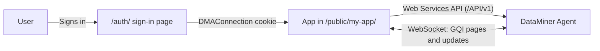

# How DataMiner App Agent apps work

This page gives a short technical overview of the apps built by the [DataMiner App Agent](xref:AIAgent_App_Agent). You do not need this knowledge to use the agent, but it helps to understand the behavior of the apps and the [deployment limitations](xref:AIAgent_App_Agent_Deploying#current-limitations).

## A static app hosted by DataMiner

The app is a React application built with [Vite](https://vite.dev/). The production build only contains static files: an `index.html` file and the JavaScript, CSS, font, and image files it uses.

The DataMiner web server hosts these files from the `C:\Skyline DataMiner\Webpages\Public` folder. Because the app is served from the same address as DataMiner itself, it can call the DataMiner Web Services API directly with relative URLs, e.g., `/API/v1/Json.asmx/...`. There is no backend, proxy, or middleware.

The agent configures the build so that all files are loaded from `/public/<app-name>/`. This is why the folder name on the DataMiner Agent must match the name used in the build. See [Deploying an app](xref:AIAgent_App_Agent_Deploying).

## Signing in

The app does not have a login page of its own:

1. The user opens the app via the DataMiner sign-in page, `/auth/?url=...`.

1. After sign-in, DataMiner sets a session cookie, `DMAConnection`, which contains the ID of the user's connection.

1. When the app loads, it reads this ID and checks that the session is still valid with the [IsConnectionAlive](xref:IsConnectionAlive) method.

1. If the session is missing or no longer valid, the app redirects the user back to the sign-in page.

All calls then use the session and permissions of the signed-in user. When the user signs out in the app, they are redirected to `/auth/logout`.

## Communicating with DataMiner

All communication between the app and DataMiner goes through the [DataMiner Web Services API](xref:Using_the_Web_Services_v1) (`/API/v1/Json.asmx`), together with a WebSocket connection for streamed results and real-time updates. The app uses that API for three things:

| Purpose | How |
|---|---|
| Session | Checking the session of the signed-in user with [IsConnectionAlive](xref:IsConnectionAlive). |
| Reading data | Running [GQI](xref:About_GQI) queries through the query session methods of the Web Services API. |
| Changing data | Executing Automation scripts with [ExecuteAutomationScriptWithOutput](xref:ExecuteAutomationScriptWithOutput). |

GQI is therefore not a separate API: it is the way the app *reads* data through the Web Services API. The agent deliberately does not use the older Web Services methods that retrieve specific objects directly, e.g., methods to get elements, parameters, or alarms. With GQI, one consistent mechanism covers all data sources, including elements, parameter tables, alarms, services, and DOM instances.

### Retrieving data

- **While the app is being built**, the agent signs in to your DataMiner System and asks the DataMiner Assistant to generate a GQI query for each data need. This is the AI-assisted part, and it requires the [Assistant DxM](xref:Intelligence_Assistant_DxM).

- **In the app**, the generated queries are embedded as fixed query definitions. The app opens a query session via the Web Services API, retrieves the rows page by page over the WebSocket connection, and, for live data, keeps the session open to receive updates when rows are added, changed, or removed. No AI is used at runtime.

This means that the app shows the same data as a low-code app with the same query, and it respects the same permissions.

### Performing actions

When the app needs to change something in DataMiner, it executes an Automation script with the [ExecuteAutomationScriptWithOutput](xref:ExecuteAutomationScriptWithOutput) method of the Web Services API and shows the result. For interactive Automation scripts, the app can render the script's dialogs in its own user interface and send the user's input back to the script.

## Testing

The agent creates [Playwright](https://playwright.dev/) end-to-end tests that start the production build locally and replace the DataMiner API and WebSocket responses with mocks. This way, the tests can cover sign-in, data loading, actions, and error situations without a connection to a DataMiner System.
