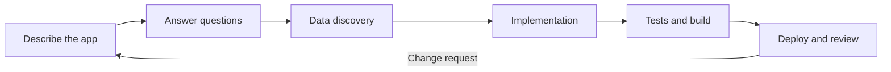

# Using the DataMiner App Agent

A session with the [DataMiner App Agent](xref:AIAgent_App_Agent) follows a fixed workflow. Knowing this workflow helps you give the right input at the right time.

## Starting a session

1. Create an empty folder for your app, or open the folder of an existing app that was built with the agent.

1. Open the folder as the workspace in your AI client, e.g., via *File > Open Folder* in Visual Studio Code.

1. Open the chat, and select *DataMiner App Agent* in the agent picker.

1. Describe what you want to build or change.

## The workflow

### 1. Classifying the request

The agent first determines whether you want to create a **new app** or **update** an existing one (a new feature, a fix, or another change). If this is not clear from your prompt, the agent asks you.

### 2. Gathering requirements

The agent always asks what the app should do, or what should change. For a new app, it makes sure it knows:

- The **name** of the app. This name is also used for the build folder and the URL of the app.
- The **key features**: what users need to see and do.
- The **data sources**: which DataMiner data the app shows, such as elements, parameters, alarms, services, or DOM instances.
- Any **write-back operations**: actions that change something in DataMiner, such as running an Automation script.

The agent does not add features you did not ask for. The more complete your initial description, the fewer questions it needs to ask. See [Best practices](xref:AIAgent_App_Agent_Best_Practices).

> [!TIP]
> For anything larger than a small app, ask the agent to [write a plan with milestones](xref:AIAgent_App_Agent_Best_Practices#make-a-plan-and-work-in-milestones) before it writes any code, and review that plan first.

### 3. Discovering data

To find the data your app needs, the agent asks for the URL of your DataMiner System and the credentials of a DataMiner user account. It uses these once to sign in and ask the DataMiner Assistant to generate a [GQI query](xref:About_GQI) for each data need, e.g., "all active alarms for elements in the Encoders view".

The discovered queries are then embedded in the app. The app itself does not use AI at runtime, and it does not store the credentials you provided.

> [!IMPORTANT]
> Use a non-production DataMiner System and a dedicated account with only the permissions the app needs. The credentials are shared with your AI client in the chat.

### 4. Implementing the app

The agent creates a React project in a dedicated subfolder of your workspace, and implements the requested features in the DataMiner style. Before it changes code, it reads the relevant [skills](xref:AIAgent_App_Agent#skills), e.g., the API skill for DataMiner integration and the frontend skill for the user interface.

The agent can run commands in your workspace, e.g., `npm install` or `npm run build`. Your AI client may ask you to allow these commands.

### 5. Testing and building

Every new app comes with [Playwright](https://playwright.dev/) end-to-end tests. These tests run against the production build, with mocked DataMiner responses, so they do not need a connection to your DataMiner System. The agent only considers the work done when the tests pass and the production build succeeds.

### 6. Deploying and reviewing

When the build is ready, the agent tells you the name of the build folder and how to open the app. Copy the folder to your DataMiner Agent as described under [Deploying an app](xref:AIAgent_App_Agent_Deploying), and review the app with real data.

## Making changes

To change an app later, open the same workspace, select the agent again, and describe the change, e.g., "Add a filter on severity to the alarm list". The agent extends the existing code and tests, rebuilds the app, and you copy the new build folder to the DataMiner Agent again.

If something does not work as expected on the DataMiner System, describe the behavior to the agent, e.g., "The alarm table stays empty after sign-in". The agent can open the app in a browser and inspect the network requests and WebSocket messages to find the cause.

## Letting the agent inspect your DataMiner System

The agent can use [Playwright](https://playwright.dev/) to open pages of your DataMiner System in a browser that you share with it. This works for the app it builds, but also for existing screens, such as a low-code app, a dashboard, or a Visual Overview in the web apps. The agent can then:

- Take screenshots of every page and panel, in different states.
- Click through the screen to see how it behaves, e.g., which panel opens when a row is selected.
- Capture the network requests and WebSocket messages, to see which data the screen requests, e.g., the GQI queries of a low-code app, and which Automation scripts it executes.

To let the agent inspect your system:

1. Ask the agent to open the page, and give it the URL, e.g., `https://my-dma/app/<app ID>`.

1. When the page redirects to the DataMiner sign-in page, the agent asks you to sign in. Sign in yourself in the shared browser, and tell the agent when you are done. Do not give the agent your credentials for this.

1. Tell the agent what to inspect and what to deliver, e.g., an inventory file with screenshots.

> [!IMPORTANT]
> The agent acts with the permissions of the account you signed in with. Use a non-production DataMiner System whenever possible, and tell the agent explicitly not to click anything that changes data, e.g., buttons that execute Automation scripts, or the *Save* and *Publish* buttons of a low-code app in edit mode.

> [!NOTE]
> Your AI client must have a browser tool that the agent can control, such as the integrated browser of Visual Studio Code or a Playwright MCP server. If the agent cannot open a browser, it tells you so.

> [!TIP]
> Commit your workspace to Git after each working version. This way, you can always return to a version that worked if a later change goes in the wrong direction.
